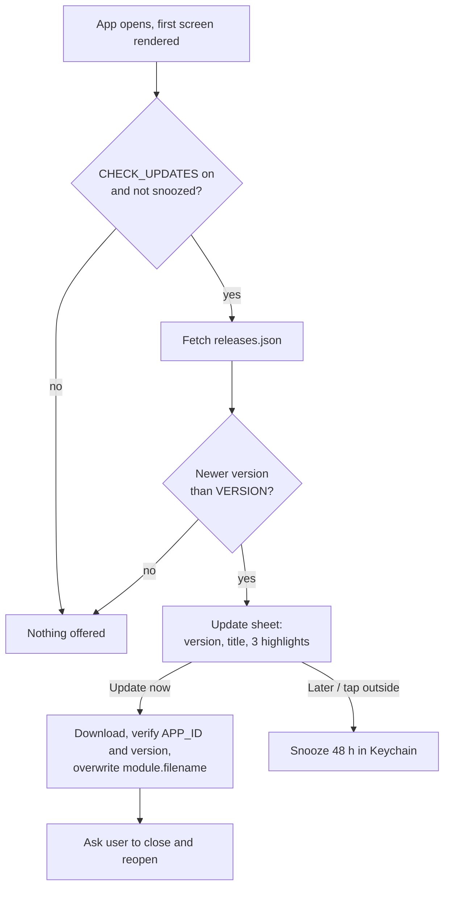

# In-app updates for Scriptable apps

## Overview

Each app checks a small `releases.json` file on GitHub when it opens, and if a newer version exists it shows an update sheet with that release's three best features, an **Update now** button and a **Later** button. Update now downloads the new script over the running one; Later hides the offer for two days. This is the pattern shipped in StravaFeed v1.6.0, written so it can be copied into Go2FGym, VisionX, CarWatch or any other Scriptable app with a WebView UI.

Four pieces make it work:

| Piece | Lives in | Job |
| --- | --- | --- |
| `VERSION` and `APP_ID` constants | The app's script | Say which build is running and which app it is |
| `releases.json` | The repository root | Source of truth: every version, its headline, three highlights, changes and fixes |
| Update check, snooze and installer | The app's script (native Scriptable side) | Fetch, compare, remember Later, write the new script |
| Update sheet | The app's HTML page (WebView side) | Show the pitch and send the user's choice back |



The check is silent until both questions pass; after that, the user's choice decides between installing now and a two-day snooze.

What the user sees: the app opens as normal, then a few seconds later a sheet slides up showing "New version 1.7.0", a headline, "You have 1.6.0", and three feature cards. After **Update now** the sheet says to close and reopen the app. After **Later**, or tapping outside the sheet, nothing is offered for 48 hours.

One limit to know before starting: the check only exists from the first version that contains it, so every user has to install that version once by hand (or through the app's installer). Every update after that is offered automatically.

## Step 1: version constants

Add these near the top of the script, right after the app's settings block. `VERSION` is what the update check compares against; `APP_ID` lets the installer confirm a download really is this app before overwriting anything.

```javascript
// This build's version. When releasing, bump it and add a matching entry to releases.json.
const VERSION = '1.0.0';
const APP_ID = 'go2fgym';   // unique per app, never changes
const REPO_RAW = 'https://raw.githubusercontent.com/gadominas/Go2FGym/main/';
const SCRIPT_FILE = 'Go2FGym.js';   // the script's file name in the repository
const UPDATE_SNOOZE_MS = 2 * 24 * 3600 * 1000;   // "Later" = 2 days
const KC_UPDATE_SNOOZE = 'go2fgym-update-snooze';   // Keychain key, unique per app
```

Also add one switch to the settings block, so a user can turn the checks off:

```javascript
CHECK_UPDATES: true,   // offer new versions from GitHub (asks again 2 days after "Later")
```

Keep the line exactly as `const VERSION = '…';` with single quotes. The installer finds the version in a downloaded file by matching that text.

## Step 2: releases.json

Create `releases.json` at the repository root, newest release first. It is the only place release notes are written: the app reads it for the update pitch, and a small tool turns it into `CHANGELOG.md` (see Releasing a new version).

```json
{
  "name": "Go2FGym",
  "appId": "go2fgym",
  "script": "Go2FGym.js",
  "releases": [
    {
      "version": "1.1.0",
      "date": "2026-11-02",
      "title": "Never miss an update",
      "highlights": [
        { "icon": "🔔", "title": "Update reminders", "text": "The app tells you when a new version is out, and waits two days if you tap Later." },
        { "icon": "⬆️", "title": "One-tap update", "text": "Update right from the app. No need to run the installer again." },
        { "icon": "✨", "title": "See what's new first", "text": "Every update shows its three best features before you install it." }
      ],
      "changes": ["Update check on start, with a pitch sheet"],
      "fixes": []
    }
  ]
}
```

Rules for each release entry:

- **`version`:** must equal the script's `VERSION`. A new feature bumps the middle number (1.1.0 → 1.2.0); a fix-only release bumps the last (1.2.0 → 1.2.1).
- **`highlights`:** exactly three, ordered by how much a user will care. These are the update pitch.
- **Highlight `title`:** two to four words naming the benefit, not the implementation ("Zoom photos", not "Pinch handler").
- **Highlight `text`:** one sentence under 100 characters saying what the user can now do.
- **Highlight `icon`:** one emoji.
- **`changes` and `fixes`:** every change, one line each. These appear only in the changelog.

When starting the file for an existing app, backfill a few past versions from its commit history. They are useful in the changelog, and they let the pitch fill all three cards for users who skip versions.

## Step 3: check for a newer version

These functions run on the Scriptable side, so they use Scriptable's `Request`, not the page's `fetch`. The check never throws and never blocks: any failure (no network, GitHub down, bad JSON) just means no update is offered this time.

```javascript
// Compares "1.10.0" and "1.9.2" as numbers: returns 1, 0 or -1.
function cmpVer(a, b) {
  const pa = String(a).split('.').map(n => parseInt(n, 10) || 0);
  const pb = String(b).split('.').map(n => parseInt(n, 10) || 0);
  for (let i = 0; i < Math.max(pa.length, pb.length); i++) {
    const d = (pa[i] || 0) - (pb[i] || 0);
    if (d) return d > 0 ? 1 : -1;
  }
  return 0;
}

async function checkForUpdate() {
  if (!CONFIG.CHECK_UPDATES || updateSnoozed()) return null;
  try {
    const req = new Request(`${REPO_RAW}releases.json?t=${Date.now()}`);
    req.timeoutInterval = 10;
    const data = await req.loadJSON();
    if (!data || !Array.isArray(data.releases)) return null;
    const newer = data.releases
      .filter(r => r && r.version && cmpVer(r.version, VERSION) > 0)
      .sort((x, y) => cmpVer(y.version, x.version));
    if (!newer.length) return null;
    // The newest release's highlights first, topped up from older versions the user skipped.
    const highlights = [];
    newer.forEach(r => (r.highlights || []).forEach(h => {
      if (highlights.length < 3 && h && h.title) highlights.push(h);
    }));
    return {
      current: VERSION, latest: newer[0].version, title: newer[0].title || '',
      skipped: newer.length, highlights, script: data.script || SCRIPT_FILE,
    };
  } catch (e) {
    console.log('Update check skipped: ' + e);
    return null;
  }
}
```

Never compare versions as text: `'1.10.0' > '1.9.0'` is false as text, which would hide every update once a version number reaches two digits. The `?t=` on the address asks GitHub's cache for a fresh copy.

## Step 4: two-day snooze

**Later** stores the moment the offer may come back, in the iOS Keychain so it survives app restarts. The check in Step 3 skips everything, including the network request, while that moment is in the future.

```javascript
function updateSnoozed() {
  try {
    return Keychain.contains(KC_UPDATE_SNOOZE) && Date.now() < +Keychain.get(KC_UPDATE_SNOOZE);
  } catch (e) { return false; }
}

function snoozeUpdate() {
  Keychain.set(KC_UPDATE_SNOOZE, String(Date.now() + UPDATE_SNOOZE_MS));
}

function clearUpdateSnooze() {
  if (Keychain.contains(KC_UPDATE_SNOOZE)) Keychain.remove(KC_UPDATE_SNOOZE);
}
```

Treat tapping outside the sheet the same as Later, so dismissing it never leads to the offer reappearing on the very next launch. Only an explicit choice snoozes it: if the user closes the whole app while the sheet is open, it shows again next time.

## Step 5: install the update safely

The installer downloads the script, checks it three ways, and only then writes it over the running script's own file. `module.filename` is the path of the script that is running, so this works whatever the user named the file and wherever they keep it.

```javascript
async function applyUpdate(info) {
  const req = new Request(`${REPO_RAW}${encodeURI(info.script || SCRIPT_FILE)}?t=${Date.now()}`);
  req.timeoutInterval = 30;
  const code = await req.loadString();
  const okStatus = req.response && req.response.statusCode === 200;
  const m = code && code.match(/const VERSION = '([^']+)'/);
  // 1. A real script for THIS app, not an error page or another project's file
  if (!okStatus || !m || !code.includes(`const APP_ID = '${APP_ID}'`)) {
    throw new Error("The download didn't look right. Try again later.");
  }
  // 2. Actually newer: GitHub's cache can serve the old file for a few minutes after a release
  if (cmpVer(m[1], VERSION) <= 0) {
    throw new Error('GitHub is still serving the old version. Try again in a few minutes.');
  }
  // 3. Write it where the running script lives (iCloud or on the phone)
  const path = module.filename;
  let fm = FileManager.local();
  try {
    const ic = FileManager.iCloud();
    if (path.startsWith(ic.documentsDirectory())) fm = ic;
  } catch (e) {}
  fm.writeString(path, code);
  return m[1];   // the version now installed
}
```

The running copy keeps working until the user closes it, so the sheet's last message asks them to close and reopen the app. Scriptable can't restart a script from inside itself.

## Step 6: the update sheet

The sheet is built by the page itself when the Scriptable side calls `window.__showUpdate(info)`. It talks back through the app's existing bridge: `send(action, params, callback)` navigates to a custom URL such as `myapp://update-now?req=…`, Scriptable's `shouldAllowRequest` handles it, and replies through `window.__done(req, ok, message)`. If an app has no bridge yet, copy `send` and `__done` from StravaFeed's page script.

Add this JavaScript to the page. It is plain ES5 with no backticks or `${`, because the page script usually sits inside a JavaScript template string on the Scriptable side.

```javascript
window.__showUpdate = function (u) {
  if (!u || document.getElementById('upd')) return;
  var ov = document.createElement('div'); ov.id = 'upd';
  var cards = (u.highlights || []).map(function (h) {
    return '<div class="updi"><span class="updic">' + escH(h.icon || '✨') + '</span><div><b>' +
      escH(h.title) + '</b><span>' + escH(h.text || '') + '</span></div></div>';
  }).join('');
  var more = u.skipped > 1 ? ' (and ' + (u.skipped - 1) + ' more update' + (u.skipped > 2 ? 's' : '') + ')' : '';
  ov.innerHTML = '<div class="updp" role="dialog" aria-label="Update available">' +
    '<div class="updtag">New version ' + escH(u.latest) + '</div>' +
    '<h2 class="updt">' + escH(u.title || 'An update is ready') + '</h2>' +
    '<div class="upds">You have ' + escH(u.current) + more + '. Here’s what you get:</div>' +
    '<div class="updl">' + cards + '</div>' +
    '<div class="updmsg" aria-live="polite"></div>' +
    '<button class="updgo" data-act="upd-now">Update now</button>' +
    '<button class="updlater" data-act="upd-later">Later, remind me in 2 days</button></div>';
  document.body.appendChild(ov);
  ov.addEventListener('click', function (e) { if (e.target === ov) updLater(); });   // outside = Later
};
function escH(t) { var d = document.createElement('div'); d.textContent = String(t == null ? '' : t); return d.innerHTML; }
function updLater() { var ov = document.getElementById('upd'); if (!ov) return; ov.remove(); send('update-later', {}); }
function updNow(btn) {
  var ov = document.getElementById('upd'), msg = ov.querySelector('.updmsg'), later = ov.querySelector('.updlater');
  btn.disabled = true; btn.textContent = 'Updating…'; later.hidden = true; msg.textContent = '';
  send('update-now', {}, function (ok, res) {
    if (ok) {
      ov.querySelector('.updtag').textContent = 'Updated to ' + res;
      msg.innerHTML = '<b>✓ Done.</b> Close the app and open it again to start using the new version.';
      btn.disabled = false; btn.textContent = 'Got it'; btn.dataset.act = 'upd-close';
    } else {
      msg.textContent = res || 'Update failed'; btn.disabled = false; btn.textContent = 'Try again'; later.hidden = false;
    }
  });
}
// In the page's existing click handler:
//   if (act === 'upd-now') updNow(t);
//   if (act === 'upd-later') updLater();
//   if (act === 'upd-close') { var uo = document.getElementById('upd'); if (uo) uo.remove(); }
```

And this CSS. It uses the app's own colour variables (`--card`, `--soft`, `--mut`, `--accent`), so it matches each app's theme in light and dark mode. Rename them to the app's variable names if they differ.

```css
#upd{position:fixed;inset:0;z-index:48;background:rgba(0,0,0,.55);display:flex;align-items:flex-end}
.updp{width:100%;background:var(--card);border-radius:22px 22px 0 0;padding:20px 18px calc(16px + env(safe-area-inset-bottom));display:flex;flex-direction:column;gap:8px}
.updtag{align-self:flex-start;background:var(--accent);color:#fff;font-size:12px;font-weight:800;padding:4px 10px;border-radius:999px}
.updt{margin:6px 0 0;font-size:22px;line-height:1.2}
.upds{color:var(--mut);font-size:14px}
.updl{display:flex;flex-direction:column;gap:10px;margin:8px 0 6px}
.updi{display:flex;gap:12px;align-items:flex-start;background:var(--soft);border-radius:14px;padding:12px}
.updic{font-size:24px;line-height:1.1;flex:none}
.updi b{display:block;font-size:15px}
.updi span{display:block;color:var(--mut);font-size:13px;line-height:1.35;margin-top:2px}
.updmsg:empty{display:none}
.updgo{padding:13px;font-size:16px}
.updlater{padding:11px;background:var(--soft);color:inherit}
```

The `escH` helper matters: release text comes from the internet, so it is always inserted as text, never as raw HTML.

## Step 7: wire it in

On the Scriptable side, inside the function that presents the WebView, keep the pending offer in a variable and show it whenever the app's main page is on screen. `js(code)` stands for the app's helper that runs code in the page (`ui.evaluateJavaScript(code + "; 'ok'")`).

```javascript
let pendingUpdate = null, updateChecked = false;
const offerUpdate = () => {
  if (pendingUpdate) js(`window.__showUpdate && window.__showUpdate(${JSON.stringify(pendingUpdate)})`);
};

// 1. Once per run, after the first screen has rendered (never before: it must not slow the start)
if (!updateChecked) {
  updateChecked = true;
  checkForUpdate().then(u => { pendingUpdate = u; offerUpdate(); });
}

// 2. After every later ui.loadHTML(...) of the main page, re-offer until answered
offerUpdate();
```

Then handle the two actions in the app's `shouldAllowRequest` action handler, before any code that needs the app's data to be loaded:

```javascript
if (head === 'update-later') {
  snoozeUpdate(); pendingUpdate = null;
  return;
}
if (head === 'update-now') {
  let ok = false, msg = '';
  try { msg = await applyUpdate(pendingUpdate); ok = true; pendingUpdate = null; clearUpdateSnooze(); }
  catch (e) { msg = String(e.message || e); }
  await js(`window.__done(${JSON.stringify(p.req)}, ${ok}, ${JSON.stringify(msg)})`);
  return;
}
```

Skip the offer on screens where the page isn't the app's own, for example while showing an external website inside the app. StravaFeed checks a `viewing` flag for this.

Finally, show the version at the bottom of the main screen, so users can tell you which build they run: `<p class="ver">Go2FGym v${VERSION}</p>`.

## Releasing a new version

Every release is four steps, always together in one push to `main`:

1. Bump `VERSION` in the script.
2. Add the release at the top of `releases.json`, with the same version and three highlights.
3. Regenerate the changelog: `node tools/changelog.js`.
4. Commit the script, `releases.json` and `CHANGELOG.md`: the script first and `releases.json` last, so the offer never appears before the new script exists.

Users see the offer the next time they open the app. GitHub can take up to about five minutes to serve new files; the installer's "not newer" check covers that gap.

Add this generator as `tools/changelog.js`. It turns `releases.json` into a readable `CHANGELOG.md`, so the two can never disagree:

```javascript
#!/usr/bin/env node
// Regenerates CHANGELOG.md from releases.json. Run from the repository root.
const fs = require('fs');
const data = JSON.parse(fs.readFileSync('releases.json', 'utf8'));
const out = ['# Changelog', '', `All notable changes to ${data.name}. Generated from \`releases.json\`; edit that file, not this one.`, ''];
for (const r of data.releases) {
  out.push(`## ${r.version} (${r.date}): ${r.title}`, '');
  for (const h of r.highlights || []) out.push(`- ${h.icon} **${h.title}**: ${h.text}`);
  if ((r.changes || []).length) { out.push('', '**Changes**', ''); r.changes.forEach(c => out.push(`- ${c}`)); }
  if ((r.fixes || []).length) { out.push('', '**Fixes**', ''); r.fixes.forEach(c => out.push(`- ${c}`)); }
  out.push('');
}
fs.writeFileSync('CHANGELOG.md', out.join('\n'));
```

Also add a `docs/RELEASING.md` to each repository with these steps and the highlight rules from Step 2 (StravaFeed's [docs/RELEASING.md](https://github.com/gadominas/StravaFeed/blob/main/docs/RELEASING.md) can be copied as is), and a short "Updates and what's new" section in the README linking to `CHANGELOG.md`.

## Testing checklist

Run these on a phone before announcing the first version that contains updates. The trick for testing the offer is to temporarily set `VERSION` lower than the latest entry in `releases.json` on GitHub.

- [ ] With `VERSION` equal to the latest release, no sheet appears.
- [ ] With `VERSION` one release behind, the sheet shows the latest version, its title and three cards.
- [ ] With `VERSION` two releases behind, the sheet says "and 1 more update", and cards are topped up from the skipped release if the newest has fewer than three.
- [ ] **Later** closes the sheet, and reopening the app shows nothing.
- [ ] Tapping outside the sheet behaves like Later.
- [ ] Switching screens before answering brings the sheet back.
- [ ] **Update now** ends on "✓ Done"; reopening the app runs the new version, shown in the version line.
- [ ] With flight mode on, the app opens normally and shows no sheet or error.
- [ ] `CHECK_UPDATES: false` stops the sheet entirely.
- [ ] The sheet looks right in both light and dark mode.

To reset Later while testing, run `Keychain.remove('go2fgym-update-snooze')` in a scratch Scriptable script, using that app's key.

## Pitfalls

All of these were hit on StravaFeed.

- **Old copies can't update themselves.** The check only exists from the version that adds it. Tell existing users to run the installer once more.
- **Order of definitions.** Scriptable runs the script top to bottom, so declare `VERSION` and the other constants above the code that starts the app. StravaFeed hit "Cannot access before initialization" errors this way, and keeps its start-up call at the very end of the file.
- **Class name clashes.** Prefix the sheet's CSS classes (StravaFeed uses `upd…`). Reusing a short name that already exists in the app, as happened with `kc`, silently restyles unrelated parts of the page.
- **A stale file right after release.** GitHub's raw file cache lags a few minutes. The installer's "not newer" check turns that into a clear "try again in a few minutes" message instead of reinstalling the same version.
- **Never trust downloaded text as HTML.** Release titles and highlights go through `escH`, so a stray `<` in the notes can't break the page.
- **Identify the right app.** StravaFeed 1.6.0 checks for a function name unique to it; new apps should use the `APP_ID` line from Step 1, which is clearer and works for any app.

## Prompt for Claude

Paste this into a chat about another app, with this doc's link, to have the pattern added. Replace the bracketed parts.

```markdown
Add in-app updates to [Go2FGym], following the attached doc "In-app updates for Scriptable apps" exactly:

- Repository: github.com/gadominas/[Go2FGym], branch main, script file [Go2FGym.js]
- APP_ID: [go2fgym]; Keychain snooze key: [go2fgym-update-snooze]
- Start this as version [1.1.0]
- Create releases.json with this release (highlights: update reminders, one-tap update, see what's new first) and backfill earlier versions from the commit history, three highlights each
- Add tools/changelog.js, generate CHANGELOG.md, add docs/RELEASING.md, and an "Updates and what's new" section to the README
- Match the sheet's colours to the app's own theme variables
- Test with VERSION temporarily lowered, in light and dark mode, then commit and push to main (no pull request)
- Record it in the app's trace (AGENTS.md › 4): the `BLUEPRINTS` line `{ id: 'in-app-updates', … version: '<this blueprint's version>', since: '<the app version being released>' }`, Settings › Built with, and docs/BLUEPRINTS.md
```

## Version history

| Version | Date | Changes |
| --- | --- | --- |
| 1.0.0 | 2026-10-27 | First versioned release |
