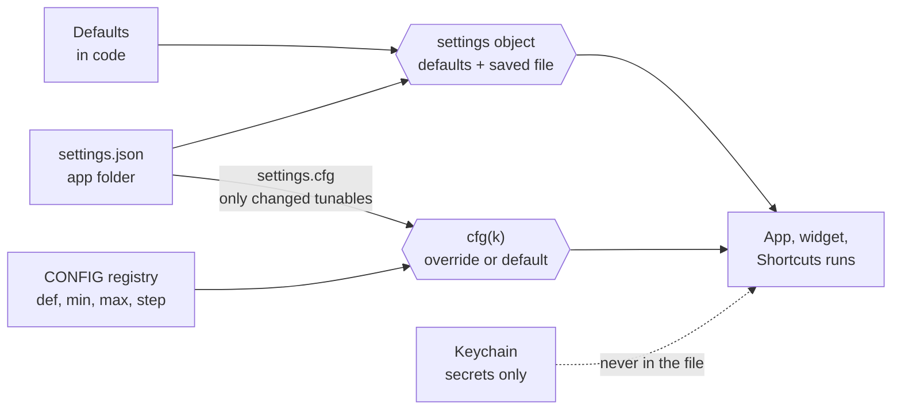

# Settings for Scriptable apps

## Overview

Every value a user might reasonably want different moves out of the code and into one Settings sheet. The code keeps only the defaults; the user's choices are saved next to the app's data and layered over those defaults, so an update never resets them and nobody edits code again.

Every app gets the same sheet, in the same order:

- **Appearance**, identical in every app: **Colours** (palette swatches, with Auto following the system), **Layout** (Comfortable, Compact, Tiny), **Text size** (Small, Default, Large, Larger) and **Headline font** (Sans serif, Serif).
- **The app's own choices**, one or two short sections of switches (BlogPulse: Reading).
- **Updates**: the offer switch and **Check for updates now**.
- **Tunables**: every number, limit and list the app runs on, grouped by area, each with its range, unit, a dot when changed and its own **Reset**, then a footer: "3 settings changed" and **Reset all** (two taps).
- **Built with**, read-only and always last: the blueprints the app was built from, each with its version and a link to read it, and a link to the blueprints repository.

Changes apply the moment they are made, with no Save button: the page redraws at once and the choice is written to disk. The sheet closes with **Done**.

Reference implementation: [BlogPulse.js](https://github.com/gadominas/BlogPulse/blob/main/BlogPulse.js) 1.1.0. The code below is taken from it, with names kept, so the two can be compared line by line. Other blueprints add their own rows to this sheet in the sections they name; their details live in those blueprints.

## Step 1: audit the hardcoded values

List every literal in the script that changes behaviour or looks, then sort each into one place. A value becomes a setting when a reasonable user would want it different and could judge the choice themselves.

| Put it in | When the value is… | Examples |
| --- | --- | --- |
| **Appearance** | How the app looks. Always these four, in every app | Colours, layout density, text size, headline font |
| **App section** (switch or segmented control) | A behaviour people form an opinion about | Mark as read when opened, show my own items |
| **Remembered pick** (inline control, also saved) | A choice made mid-task, right where it's used | Group by day or week, current tab or filter |
| **Tunables** (registry with range and Reset) | A number, limit or list people may tune, with a safe range | Time limit per request, items kept, refresh interval, quick-reply presets |
| **Updates** | Update behaviour (from the in-app updates blueprint) | Offer new versions |
| **Internal state** (same file, never shown) | Something the app records for itself | Last visit, last check |
| **Code constant** | Fixed by how the app works | URLs, endpoints, `VERSION`, file and Keychain names |

BlogPulse as the worked example:

| Former value | Now | Control | Section |
| --- | --- | --- | --- |
| Colours, density, text size, font | `settings.theme`, `density`, `textSize`, `font` | Swatches, segmented controls | Appearance |
| `readOnOpen` | `settings.readOnOpen` | Switch | Reading |
| `checkUpdates` | `settings.checkUpdates` | Switch, plus **Check** | Updates |
| `groupBy`, `view` | Remembered picks in `settings` | Inline controls on the main screen | Not in the sheet |
| Fetch time limit, blogs checked at once, browser identity | `CONFIG` registry, sparse overrides in `settings.cfg` | Stepper, text field | Checking blogs |
| Keep posts for, keep at most, new blog backlog, posts per page | `CONFIG` registry | Stepper | Keeping posts |
| Widget refresh and check budget | `CONFIG` registry | Stepper | Widget |
| Quick instructions for invites | `CONFIG` registry | One per line | Invites |
| `lastSession`, `lastScan` | Internal state in `settings` | None | |
| `APP`, `VERSION`, catalog URLs | Code constants | None | |

Aim for one screen per section. A sheet with every knob in it is as unusable as editing code, which is why tunables carry a range, a unit and a one-line explanation.

## Step 2: where settings live

One JSON file, `settings.json`, in the app's own folder in Scriptable's documents (iCloud Drive when available, so choices follow the user to another device). It holds three kinds of value side by side:



| Store | Holds | Written by |
| --- | --- | --- |
| Defaults in code | Every choice's starting value | You, in code |
| `settings` (in `settings.json`) | Appearance, app choices, remembered picks, internal state | The sheet and inline controls, at once |
| `settings.cfg` (inside the same file) | Only the tunables the user changed | The sheet's tunable fields; deleted again on Reset |
| Keychain | Keys and tokens, one entry each, never in the file | A native secure prompt (Step 7) |

Updates replace only the script, so everything in the file and the Keychain survives every update.

```javascript
// ---------- storage ----------
const fm = (() => { try { return FileManager.iCloud(); } catch (e) { return FileManager.local(); } })();
const DIR = fm.joinPath(fm.documentsDirectory(), APP);
if (!fm.fileExists(DIR)) fm.createDirectory(DIR, true);
const P = n => fm.joinPath(DIR, n + ".json");
async function load(n, def) {
  const p = P(n);
  if (!fm.fileExists(p)) return def;
  try {
    if (fm.isFileStoredIniCloud(p) && !fm.isFileDownloaded(p)) await fm.downloadFileFromiCloud(p);
    return JSON.parse(fm.readString(p));
  } catch (e) { return def; }   // a broken file falls back to defaults, never crashes
}
const write = (n, v) => fm.writeString(P(n), JSON.stringify(v));

// Defaults first, saved choices on top.
const settings = Object.assign(
  { groupBy: "day", view: "unread", readOnOpen: false, lastSession: 0, lastScan: 0,
    checkUpdates: true,   // offer new versions from GitHub (asks again 2 days after "Later")
    theme: "auto", density: "comfortable", font: "sans", textSize: 1 },
  await load("settings", {})
);
```

Rules:

- **Load before anything runs**, including the widget and Shortcuts branches, so they use the user's choices, not the defaults.
- **Save after every change.** iOS can end a Scriptable script at any moment; nothing waits for the sheet to close.
- **One file per app**, named by the app's folder. Keys and tokens never go in it: it's plain JSON in iCloud Drive.

## Step 3: Appearance, the common part

These four settings and their controls are the same in every app, so the apps feel like one family. Each app keeps its own palette colours; the names, controls, options and order never change.

### Colour tokens

Every colour in the app's CSS comes from these tokens, and nothing else. An app adopting this blueprint renames its colour variables to them (or aliases them).

| Token | Use |
| --- | --- |
| `--paper` | Page background |
| `--sheet` | Cards, rows, controls |
| `--ink`, `--ink-2` | Text, secondary text |
| `--muted` | Hints, captions |
| `--rule` | Borders and dividers |
| `--signal`, `--signal-wash` | The accent and a pale fill behind it |
| `--amber`, `--amber-wash` | Warnings and highlights |
| `--danger` | Destructive actions and errors |

### Palettes

Six palettes plus **Auto**, which follows the system: the first light palette in light mode, `night` in dark mode, and it switches live when the system does. `contrast` is there for readability; keep it in every app.

```javascript
const PALETTES = {
  ink:      { paper: "#f6f7f9", sheet: "#ffffff", ink: "#0f172a", ink2: "#334155", muted: "#5b6475", rule: "#dde2ea", signal: "#1d4ed8", signalWash: "#e5edff", amber: "#b45309", amberWash: "#fdf0dc", danger: "#b91c1c", scheme: "light" },
  sepia:    { paper: "#f3ead6", sheet: "#fbf5e6", ink: "#2a1f14", ink2: "#4b3b2a", muted: "#73604a", rule: "#e1d3b5", signal: "#8a3b12", signalWash: "#f3dfc8", amber: "#a16207", amberWash: "#f6e5bf", danger: "#9f1239", scheme: "light" },
  mint:     { paper: "#f1f6f3", sheet: "#ffffff", ink: "#0d2318", ink2: "#2c4a3b", muted: "#556d60", rule: "#d3e2d9", signal: "#15803d", signalWash: "#dcf3e4", amber: "#b45309", amberWash: "#fbeed8", danger: "#b91c1c", scheme: "light" },
  contrast: { paper: "#ffffff", sheet: "#ffffff", ink: "#000000", ink2: "#111111", muted: "#333333", rule: "#9a9a9a", signal: "#0033cc", signalWash: "#e0e8ff", amber: "#7a4b00", amberWash: "#ffeec2", danger: "#a30000", scheme: "light" },
  slate:    { paper: "#1c2128", sheet: "#22272e", ink: "#e6edf3", ink2: "#c5ced8", muted: "#9aa5b1", rule: "#373e47", signal: "#6cb6ff", signalWash: "#1d3350", amber: "#e3b341", amberWash: "#3a2f12", danger: "#ff8a7a", scheme: "dark" },
  night:    { paper: "#05070b", sheet: "#0f141c", ink: "#f3f6fa", ink2: "#d0d7e1", muted: "#9aa4b2", rule: "#1f2733", signal: "#7ab4ff", signalWash: "#132640", amber: "#f5c04a", amberWash: "#2d240c", danger: "#ff8f7a", scheme: "dark" },
};
const PALETTE_CSS = Object.entries(PALETTES).map(([k, p]) => `[data-theme=${k}]{--paper:${p.paper};--sheet:${p.sheet};--ink:${p.ink};--ink-2:${p.ink2};--muted:${p.muted};--rule:${p.rule};--signal:${p.signal};--signal-wash:${p.signalWash};--amber:${p.amber};--amber-wash:${p.amberWash};--danger:${p.danger};color-scheme:${p.scheme}}`).join("\n");
```

An app may change the palette colours to suit its brand (StravaFeed's accent is Strava orange), but keeps the six palette names, `scheme` for each, and readable contrast in all of them.

### Layout, text size and font

Three more tokens carry the rest of the look. Every font size in the app is written as `calc(<px> * var(--ts))`, and every card spacing uses the density tokens, so one setting changes the whole page.

| Setting | Options (value) | Applied as |
| --- | --- | --- |
| Layout | Comfortable (`comfortable`), Compact (`compact`), Tiny (`tiny`) | `body.d-<value>` overrides `--t`, `--d`, `--m`, `--pad` (title, body, meta sizes and card padding). Tiny may also switch lists to one-line rows |
| Text size | Small (`0.92`), Default (`1`), Large (`1.12`), Larger (`1.25`) | `--ts` on the root element, a multiplier inside every font size |
| Headline font | Sans serif (`sans`), Serif (`serif`) | `html[data-font]` swaps `--display`, the font of titles and headings |
| Colours | Auto, then the six palettes | `html[data-theme]` selects a palette's tokens |

```css
:root{
  --ts:1; --serif: ui-serif, "New York", Georgia, serif; --sans: -apple-system, system-ui, "SF Pro Text", sans-serif; --display: var(--sans);
  --t:19px; --d:16px; --m:13.5px; --pad:16px;
}
html[data-font=serif]{--display:var(--serif)}
${PALETTE_CSS}
body.d-compact{--t:16.5px;--d:14.5px;--m:12.5px;--pad:11px}
body.d-tiny{--t:15.5px;--m:12px;--pad:9px}
html,body{margin:0;background:var(--paper);color:var(--ink);font-family:var(--sans);font-size:calc(16px * var(--ts));line-height:1.5;-webkit-text-size-adjust:100%}
```

### Applying the look in the page

The page applies the look itself, at start and on every change, so a tap redraws instantly without waiting for the Scriptable side.

```javascript
const look = { theme: S.settings.theme || "auto", density: S.settings.density || "comfortable", font: S.settings.font || "sans", textSize: +S.settings.textSize || 1 };
const THEMES = [["auto", "Auto"]].concat(Object.keys(S.palettes).map(k => [k, k[0].toUpperCase() + k.slice(1)]));
const dark = window.matchMedia ? matchMedia("(prefers-color-scheme: dark)") : { matches: false };
function applyLook() {
  const root = document.documentElement;
  root.dataset.theme = look.theme === "auto" ? (dark.matches ? "night" : "ink") : look.theme;
  root.dataset.font = look.font;
  root.style.setProperty("--ts", look.textSize);
  document.body.classList.remove("d-comfortable", "d-compact", "d-tiny");
  document.body.classList.add("d-" + look.density);
}
const onDark = () => { if (look.theme === "auto") applyLook(); };
if (dark.addEventListener) dark.addEventListener("change", onDark); else if (dark.addListener) dark.addListener(onDark);

const segRow = (k, opts) => `<div class="seg wide">${opts.map(([v, l]) => `<button class="${String(look[k]) === String(v) ? "on" : ""}" data-act="look" data-k="${k}" data-v="${v}">${l}</button>`).join("")}</div>`;
function lookHTML() {
  return `
    <div class="lk-row"><span class="lk-l">Colours</span><div class="sws">${THEMES.map(t => `
      <button class="sw ${look.theme === t[0] ? "on" : ""}" data-act="look" data-k="theme" data-v="${t[0]}" aria-label="${t[1]} colours">
        <span class="prev" style="${t[0] === "auto" ? `background:linear-gradient(135deg,${S.palettes.ink.paper} 50%,${S.palettes.night.sheet} 50%);color:${S.palettes.night.signal}` : `background:${S.palettes[t[0]].paper};color:${S.palettes[t[0]].ink}`}">Aa<i style="background:${(S.palettes[t[0]] || S.palettes.night).signal}"></i></span>
        <small>${t[1]}</small></button>`).join("")}</div></div>
    <div class="lk-row"><span class="lk-l">Layout</span>${segRow("density", [["comfortable", "Comfortable"], ["compact", "Compact"], ["tiny", "Tiny"]])}</div>
    <div class="lk-row"><span class="lk-l">Text size</span>${segRow("textSize", [[0.92, "Small"], [1, "Default"], [1.12, "Large"], [1.25, "Larger"]])}</div>
    <div class="lk-row"><span class="lk-l">Headline font</span>${segRow("font", [["sans", "Sans serif"], ["serif", "Serif"]])}</div>`;
}

// In the page's click handler:
case "look": {
  const k = t.dataset.k, val = k === "textSize" ? +v : v;
  look[k] = val; send("set", { k, v: val }); render(); renderCfg(); break;
}
```

Each swatch previews its palette: its paper as the background, "Aa" in its ink and a dot in its accent. The Auto swatch is split diagonally between the light and dark palettes.

## Step 4: tunables, the registry

Numbers, limits and lists the app runs on are declared once, in a `CONFIG` registry near the top of the script. The registry is the single source of truth: its defaults, the validation and the Settings fields all come from it, so adding a tunable is one line.

```javascript
// Everything tunable lives here; the Settings screen edits these (stored in settings.cfg, defaults below).
const CONFIG = [
  ["Checking blogs", [
    { k: "fetchTimeout", label: "Time limit per blog", help: "How long to wait for one blog before giving up", unit: "s", def: 15, min: 5, max: 60, step: 1 },
    { k: "concurrency", label: "Blogs checked at once", help: "Higher is faster but heavier on the network", unit: "", def: 6, min: 1, max: 12, step: 1 },
    { k: "userAgent", label: "Browser identity", help: "The User-Agent sent to blogs; some sites block unknown readers", type: "text", def: DEFAULT_UA },
  ]],
  ["Keeping posts", [
    { k: "maxAgeDays", label: "Keep posts for", help: "Older posts are removed unless you rated them", unit: "days", def: 90, min: 7, max: 365, step: 7 },
    { k: "maxArticles", label: "Keep at most", help: "Rated posts are kept first, then the newest", unit: "posts", def: 2000, min: 200, max: 10000, step: 100 },
  ]],
  ["Invites", [
    { k: "invitePresets", label: "Quick instructions", help: "One per line; shown as chips in the invite composer", type: "lines", def: ["Short and casual", "For my team on Slack", "Ask what they think"] },
  ]],
];
const CFG_FLAT = CONFIG.flatMap(([, items]) => items);
const cfgDef = k => CFG_FLAT.find(x => x.k === k);
const cfg = k => { const v = settings.cfg && settings.cfg[k]; return v === undefined ? cfgDef(k).def : v; };
function setCfg(k, v) {
  const d = cfgDef(k);
  if (!d) return;
  settings.cfg = settings.cfg || {};
  if (v === null) { delete settings.cfg[k]; return; }   // Reset
  if (d.type === "text") v = String(v || "").trim() || d.def;
  else if (d.type === "lines") { v = String(Array.isArray(v) ? v.join("\n") : v || "").split("\n").map(x => x.trim()).filter(Boolean).slice(0, 20); if (!v.length) v = d.def; }
  else {
    v = Number(String(v).replace(",", "."));   // accept a decimal comma
    if (!isFinite(v)) v = d.def;
    v = Math.min(d.max, Math.max(d.min, v));
    v = d.step < 1 ? Math.round(v / d.step) * d.step : Math.round(v);
    v = Number(v.toFixed(2));
  }
  if (JSON.stringify(v) === JSON.stringify(d.def)) delete settings.cfg[k]; else settings.cfg[k] = v;   // store only what differs
}
```

| Field | Meaning |
| --- | --- |
| `k` | Key in `settings.cfg`; never rename one, or the user's value is lost |
| `label`, `help` | What the user gets, and the effect or trade-off (copy guidelines below) |
| `unit` | Shown after the number: s, min, h, days, posts, chars |
| `def`, `min`, `max`, `step` | Default and the safe range; out-of-range input is clamped, not rejected |
| `type` | Omitted for numbers (stepper); `"text"` for one line; `"lines"` for a list, one item per line |

Rules:

- **The code reads `cfg("key")` everywhere**, never the literal. A tunable that the code doesn't read through `cfg` is a bug.
- **Only changed values are stored.** Setting a value back to its default deletes it, so a future release can improve a default and everyone who never touched it gets the improvement.
- **Validation lives on the Scriptable side** (`setCfg`). The page may show anything; what is stored is always in range.
- **Side effects run right after the change**, on the Scriptable side: shrinking "Keep at most" prunes immediately, not at the next check.

## Step 5: the Settings sheet

### Entry point

- **Where:** the header's top-right action group, left of refresh. The header stays reachable while scrolling.
- **Icon:** an inline SVG line icon, never a text symbol like ⚙︎, which fonts draw at unpredictable sizes. BlogPulse uses a sliders glyph. Same size, stroke and colour as its neighbours: 20 by 20 inside the button, stroke 2, `currentColor`.
- **Button:** 40 by 40, round, `--sheet` background with a `--rule` border (the shared `.icon` style), `aria-label="Settings"`.

```javascript
const SETTINGS_SVG = `<svg viewBox="0 0 24 24"><path d="M4 7h9M17 7h3M4 17h3M11 17h9"/><circle cx="15" cy="7" r="2"/><circle cx="9" cy="17" r="2"/></svg>`;
// in the header:
`<div class="tb-a"><button class="icon" data-act="cfgopen" aria-label="Settings">${SETTINGS_SVG}</button>` +
`<button class="icon spin" data-act="refresh" aria-label="Refresh">${REFRESH_SVG}</button></div>`
```

### Sheet anatomy

| Part | Spec |
| --- | --- |
| Sheet | Full screen, slides up in 0.28 s (`transform: translateY(102%)` → none), `--paper` background, scrolls on its own; the page behind is locked |
| Header | Sticky. "Settings" in the display font, 24 × `--ts`, bold, left; **Done** in the accent colour, right. Top padding includes the safe area |
| Hint | "Changes apply right away and are kept on this iPhone." in muted 13 × `--ts` |
| Section heading | Small and quiet so it reads as a heading, not a row: 12.5 × `--ts`, bold, uppercase, letter-spaced, `--muted`, 28 above the card and 8 between heading and card |
| Section card | Every section's rows sit in one card: `--sheet` fill (lighter than the page in dark palettes, white on light ones), a 1 px `--rule` border, 16 radius, 16 side padding. The card's top and bottom edges are where the section starts and ends; rows inside are divided by hairlines and the last row has none. A section's explanation (Built with) and the changed-count footer sit outside the card |
| Switch row | Label (semibold) and one muted line under it, switch right (46 × 28, accent when on); divider under the row unless it is the card's last |
| Segmented control | Full width, equal buttons, the selected one in `--ink` on `--paper` |
| Swatches | A row of 50 × 50 previews with the name under each; the selected one outlined in the accent; scrolls sideways if needed |
| Tunable | Label with **Reset** on the right when changed, a dot after the label when changed, help line; then − field + unit, with "5–60 — original 15" under it. Text and list tunables get a full-width field instead |
| Footer | "3 settings changed" or "All settings are at their original values", and **Reset all** (danger, two taps) |
| Built with | Read-only rows: blueprint name, "Blueprint 1.0.0 · since BlogPulse 1.1.0", a › on the right; tapping a row opens that blueprint version; a last row opens the repository |

Section order, the same in every app:

1. **Appearance** (Step 3).
2. **The app's own sections**, most used first (BlogPulse: Reading).
3. **Updates**: offer switch, then "Check for updates now" with its result line.
4. **Tunables**, one section per registry group, in registry order, with the changed count and **Reset all** under the last one.
5. **Built with** (Step 9), always last.

### Page code

```javascript
let cfgOpen = false, cfgArmed = false;
const cfgItem = k => { for (const sec of S.cfgSchema) for (const d of sec.items) if (d.k === k) return d; return null; };
const cfgChanged = k => { const d = cfgItem(k); return d && JSON.stringify(S.cfg[k]) !== JSON.stringify(d.def); };
const fmtCfg = (d, v) => d.step && d.step < 1 ? Number(v).toFixed(String(d.step).split(".")[1].length) : String(v);
function renderCfg() {
  const el = $("#cfgsheet"), keepTop = el.scrollTop;
  el.classList.toggle("open", cfgOpen); lockBody();
  if (!cfgOpen) return;
  const field = d => {
    const v = S.cfg[d.k], ch = cfgChanged(d.k);
    const reset = ch ? `<button class="link small" data-act="cfgreset" data-k="${d.k}">Reset</button>` : "";
    const head = `<div class="cfg-h"><b>${esc(d.label)}</b>${reset}</div>${d.help ? `<small class="muted">${esc(d.help)}</small>` : ""}`;
    if (d.type === "text") return `<div class="cfg ${ch ? "ch" : ""}">${head}<input class="cfgin wide" data-k="${d.k}" value="${esc(v)}" autocapitalize="off" autocorrect="off" spellcheck="false"></div>`;
    if (d.type === "lines") return `<div class="cfg ${ch ? "ch" : ""}">${head}<textarea class="cfgin wide" data-k="${d.k}" rows="${Math.max(4, v.length + 1)}">${esc(v.join("\n"))}</textarea></div>`;
    return `<div class="cfg ${ch ? "ch" : ""}">${head}
      <div class="stepper"><button data-act="cfgstep" data-k="${d.k}" data-v="-1" aria-label="Decrease" ${v <= d.min ? "disabled" : ""}>−</button>
      <input class="cfgin" data-k="${d.k}" value="${fmtCfg(d, v)}" inputmode="decimal" aria-label="${esc(d.label)}">
      <button data-act="cfgstep" data-k="${d.k}" data-v="1" aria-label="Increase" ${v >= d.max ? "disabled" : ""}>+</button>
      <span class="unit">${esc(d.unit || "")}</span><span class="range">${fmtCfg(d, d.min)}–${fmtCfg(d, d.max)}${ch ? ` — original ${fmtCfg(d, d.def)}` : ""}</span></div></div>`;
  };
  const changed = Object.keys(S.cfg).filter(cfgChanged).length;
  el.innerHTML = `<div class="sh-head"><h2>Settings</h2><button class="link" data-act="cfgclose">Done</button></div><div class="sh-body">
    <p class="hint">Changes apply right away and are kept on this iPhone.</p>
    <h3 class="sec">Appearance</h3><div class="grp">${lookHTML()}</div>
    <h3 class="sec">Reading</h3><div class="grp">
    <div class="srow"><div class="grow"><b>Mark as read when opened</b><small class="muted">Off: you mark posts read yourself</small></div><button class="switch ${S.settings.readOnOpen ? "on" : ""}" data-act="toggle" data-v="readOnOpen" aria-label="Mark as read when opened"></button></div>
    </div>
    <h3 class="sec">Updates</h3><div class="grp">
    <div class="srow"><div class="grow"><b>Offer new versions</b><small class="muted">You have BlogPulse ${esc(S.version)}. “Later” waits two days.</small></div><button class="switch ${S.settings.checkUpdates ? "on" : ""}" data-act="toggle" data-v="checkUpdates" aria-label="Offer new versions"></button></div>
    <div class="srow"><div class="grow"><b>Check for updates now</b><small id="updmsg" class="muted" aria-live="polite"></small></div><button class="sm" data-act="updcheck">Check</button></div>
    </div>
    ${S.cfgSchema.map(sec => `<h3 class="sec">${esc(sec.title)}</h3><div class="grp">${sec.items.map(field).join("")}</div>`).join("")}
    <div class="aic-btns cfg-foot"><span class="note">${changed ? changed + " setting" + (changed === 1 ? "" : "s") + " changed" : "All settings are at their original values"}</span>
      ${changed ? `<button class="sm danger ${cfgArmed ? "armed" : ""}" data-act="cfgall">${cfgArmed ? "Confirm reset" : "Reset all"}</button>` : ""}</div>
  </div>`;
  el.scrollTop = keepTop;   // re-renders must not jump the user back to the top
}

// In the page's click handler:
case "toggle": S.settings[v] = !S.settings[v]; send("set", { k: v, v: S.settings[v] }); renderCfg(); break;
case "cfgopen": cfgOpen = true; renderCfg(); break;
case "cfgclose": cfgOpen = false; cfgArmed = false; renderCfg(); break;
case "cfgreset": { const d = cfgItem(t.dataset.k); S.cfg[d.k] = d.def; send("cfg", { k: d.k, v: null }); renderCfg(); break; }
case "cfgstep": {
  const d = cfgItem(t.dataset.k), step = d.step || 1;
  const nv = Number(Math.min(d.max, Math.max(d.min, Number(S.cfg[d.k]) + step * +v)).toFixed(2));
  S.cfg[d.k] = nv; send("cfg", { k: d.k, v: nv }); renderCfg(); break;
}
case "cfgall":
  if (cfgArmed) { cfgArmed = false; send("cfg", { k: "*" }); }
  else { cfgArmed = true; renderCfg(); setTimeout(() => { if (cfgArmed) { cfgArmed = false; renderCfg(); } }, 3500); }
  break;

// Typed values arrive through "change", when the field loses focus:
document.addEventListener("change", e => {
  if (e.target.classList && e.target.classList.contains("cfgin")) {
    const d = cfgItem(e.target.dataset.k);
    send("cfg", { k: d.k, v: d.type === "lines" ? e.target.value.split("\n") : e.target.value });
  }
});
```

Every section is a heading followed by one `<div class="grp">` holding all of its rows: never put a row outside a card, and never put two sections in one card.

The page code above is modern JavaScript because BlogPulse's page is a real function serialised with `toString()`. If an app builds its page inside a template string, write the same logic in ES5 without backticks or `${`.

### CSS

```css
.sheet{position:fixed;inset:0;z-index:10;background:var(--paper);transform:translateY(102%);transition:transform .28s ease;overflow-y:auto;-webkit-overflow-scrolling:touch}
.sheet.open{transform:none}
#cfgsheet{z-index:13}
body.locked{overflow:hidden}
.tb-a{display:flex;gap:6px}
.icon{width:40px;height:40px;border-radius:20px;display:grid;place-items:center;background:var(--sheet);border:1px solid var(--rule)}
.icon svg{width:20px;height:20px;stroke:currentColor;fill:none;stroke-width:2;stroke-linecap:round;stroke-linejoin:round}
.sh-head{position:sticky;top:0;z-index:2;background:var(--paper);display:flex;justify-content:space-between;align-items:center;padding:calc(env(safe-area-inset-top) + 14px) 18px 12px;border-bottom:1px solid var(--rule)}
.sh-head h2{font:700 calc(24px * var(--ts))/1 var(--display);margin:0}
.sh-body{padding:16px 18px calc(env(safe-area-inset-bottom) + 40px)}
.link{color:var(--signal);font-weight:600;font-size:16px}
.link.small{font-size:calc(14px * var(--ts))}
.hint{font-size:calc(13px * var(--ts));color:var(--muted);margin:8px 2px 0}
.sec{font:700 calc(12.5px * var(--ts))/1.2 var(--sans);letter-spacing:.08em;text-transform:uppercase;color:var(--muted);margin:28px 4px 8px}
.grp{background:var(--sheet);border:1px solid var(--rule);border-radius:16px;padding:0 16px;overflow:hidden}
.grp>.srow:last-child,.grp>.cfg:last-child,.grp>.lk-row:last-child{border-bottom:0}
.grp .lk-row{margin:0;padding:12px 0;border-bottom:1px solid var(--rule)}
.srow{display:flex;align-items:center;gap:8px;padding:11px 0;border-bottom:1px solid var(--rule)}
.grow{flex:1;min-width:0}
.grow b{display:block;font-weight:600}
.grow small{display:block;font-size:calc(13px * var(--ts));color:var(--ink-2)}
.switch{width:46px;height:28px;border-radius:14px;background:var(--rule);position:relative;flex:none;transition:background .2s}
.switch::after{content:"";position:absolute;top:3px;left:3px;width:22px;height:22px;border-radius:11px;background:#fff;box-shadow:0 1px 2px rgba(0,0,0,.25);transition:transform .2s}
.switch.on{background:var(--signal)}
.switch.on::after{transform:translateX(18px)}
.sm{font-size:calc(13px * var(--ts));padding:6px 11px;border-radius:8px;border:1px solid var(--rule);background:var(--sheet);white-space:nowrap}
.danger{color:var(--danger)}
.danger.armed{background:var(--danger);color:#fff;border-color:var(--danger)}
.seg{display:flex;border:1px solid var(--rule);border-radius:9px;overflow:hidden;flex:none;background:var(--sheet)}
.seg button{font-size:calc(12.5px * var(--ts));padding:6px 10px;color:var(--ink-2);white-space:nowrap}
.seg button.on{background:var(--ink);color:var(--paper);font-weight:600}
.seg.wide button{flex:1;text-align:center;padding:9px 4px;font-size:calc(13.5px * var(--ts))}
.lk-row{margin:10px 0 14px}
.lk-l{display:block;font-size:calc(13px * var(--ts));font-weight:600;color:var(--ink-2);margin-bottom:6px}
.sws{display:flex;gap:12px;overflow-x:auto;scrollbar-width:none;padding:3px 3px 2px}
.sws::-webkit-scrollbar{display:none}
.sw{display:flex;flex-direction:column;align-items:center;gap:5px;flex:none}
.sw .prev{position:relative;width:50px;height:50px;border-radius:13px;display:grid;place-items:center;border:1px solid rgba(127,127,127,.35);font:700 18px/1 var(--display)}
.sw .prev i{position:absolute;right:6px;bottom:6px;width:9px;height:9px;border-radius:5px}
.sw.on .prev{outline:2.5px solid var(--signal);outline-offset:2px}
.sw small{font-size:12px;color:var(--ink-2)}
.sw.on small{color:var(--ink);font-weight:600}
.cfg{padding:12px 0;border-bottom:1px solid var(--rule)}
.cfg.ch .cfg-h b::after{content:"";display:inline-block;width:7px;height:7px;border-radius:4px;background:var(--signal);margin-left:7px;vertical-align:2px}
.cfg-h{display:flex;justify-content:space-between;align-items:baseline;gap:10px}
.cfg-h b{font-weight:600}
.cfg small{display:block;font-size:calc(13px * var(--ts));margin-top:2px}
.stepper{display:flex;align-items:center;gap:6px;margin-top:8px;flex-wrap:wrap}
.stepper button{width:38px;height:36px;border-radius:9px;border:1px solid var(--rule);background:var(--sheet);font-size:20px;font-weight:600;text-align:center}
.stepper button[disabled]{opacity:.35}
.stepper input{width:86px;text-align:center;font:600 16px var(--sans);padding:7px 6px;border-radius:9px;border:1px solid var(--rule);background:var(--paper);color:var(--ink)}
.stepper .unit{font-size:calc(14px * var(--ts));color:var(--ink-2);min-width:2.5em}
.stepper .range{flex-basis:100%;font-size:calc(12px * var(--ts));color:var(--muted)}
.cfgin.wide{display:block;width:100%;margin-top:8px;font:16px/1.45 var(--sans);padding:9px 11px;border-radius:9px;border:1px solid var(--rule);background:var(--paper);color:var(--ink)}
.cfgin:focus{outline:2px solid var(--signal);outline-offset:-1px}
.cfg-foot{margin:10px 4px 0}
button.srow{width:100%;text-align:left}
```

Input fields stay at 16px regardless of text size; anything smaller makes iOS zoom the page when the field is tapped.

## Step 6: saving

There is no Save button: every control sends its change the moment it is used, and the Scriptable side validates, stores and pushes fresh state back.

| Action | Payload | What the Scriptable side does |
| --- | --- | --- |
| `set` | `k`, `v` | Stores `settings[k]` if `k` is on the allowed list; saves |
| `cfg` | `k`, `v` (`null` = reset one, `k: "*"` = reset all) | `setCfg`, then any side effect (prune, re-sort); saves; pushes state |
| `updcheck` | none | From the in-app updates blueprint: clears "Later" and checks now |

```javascript
// Inside the app's action handler (m = the decoded message from the page)
case "set": if (["groupBy", "view", "readOnOpen", "theme", "density", "font", "textSize", "checkUpdates"].includes(m.k)) settings[m.k] = m.v; break;   // then saveAll()
case "cfg": {
  if (m.k === "*") settings.cfg = {}; else setCfg(m.k, m.v);
  if (m.k === "*" || m.k === "maxAgeDays" || m.k === "maxArticles") prune();   // side effects apply now
  saveAll(); return push();
}
```

Add to the state the app sends the page:

```javascript
cfg: Object.fromEntries(CFG_FLAT.map(d => [d.k, cfg(d.k)])),        // effective values
cfgSchema: CONFIG.map(([title, items]) => ({ title, items })),
settings: { /* …the app's own fields… */ readOnOpen: settings.readOnOpen, checkUpdates: settings.checkUpdates !== false,
  theme: settings.theme, density: settings.density, font: settings.font, textSize: settings.textSize },
palettes: PALETTES, version: VERSION,
```

What a change does, and what the user is told:

| Effect | When | Example | Feedback |
| --- | --- | --- | --- |
| **Redraw** | Looks and display choices | Colours, layout, text size | The page changes under the open sheet |
| **Apply now** | A tunable with a side effect | Keep at most | Done by the time the user scrolls back |
| **Next run** | Something used only during a check or by the widget | Time limit per blog, widget refresh | Say so in the help line ("applies to newly found posts") |

The `set` allow-list matters: the page can only change the keys listed, so a stale or tampered page can't write anything else into the settings file.

## Step 7: secrets

Keys and tokens are not settings. Each lives in its own Keychain entry, named with the app's prefix, and is typed into a native secure prompt, never into the page: the page's history, logs and bridge URLs could all carry it.

- **In the sheet**, a secret is a row showing "Saved, ending …WXYZ" or "Not set", with **Add** or **Change** (opens the native prompt) and **Remove** (two taps; turns into **Confirm** for 3.5 seconds).
- **Saved at once** when the prompt is confirmed; Done or closing the sheet never touches it.
- **The page gets only the last four characters**, enough for people to recognise the key.
- **Changing it is a separate action** (`secret-set`, `secret-remove`), handled before anything that needs the app's data, so a broken key can always be fixed.

## Step 8: wiring

1. **Load first, everywhere.** Load `settings` at the top of the script, before the app, widget and Shortcuts branches.
2. **Apply the look before the first paint.** Call `applyLook()` as soon as state arrives, so the page never flashes the default palette.
3. **The header button** goes left of refresh, both as matching line icons (Step 5).
4. **Stacking.** The Settings sheet sits above the page's other sheets (`z-index: 13` in BlogPulse); sheets opened from it go higher.
5. **Gestures.** Add the sheet to every "is an overlay open" check, such as pull to refresh, so dragging inside it never reloads the app.
6. **The widget** reads the same `settings` and `cfg()` values. Where it draws colours, it uses the palette in use (Auto: light or dark by the system).

## Step 9: Built with, the blueprint trace

Every app records which blueprints it was built from, and which version of each, in one block in its script. The block is the app's own trace: inventory tools read it from the repository without running the script, and the Settings sheet shows it to the user as **Built with**. The rules for keeping it right are in [AGENTS.md › Blueprint versions and traces](../AGENTS.md#4-blueprint-versions-and-traces).

```javascript
// ───────── Blueprints ─────────
// Shared blueprints this app was built with (github.com/gadominas/app-blueprints). One line per blueprint, in this exact shape:
// inventory tools read it without running the script, and Settings › Built with shows it.
const BLUEPRINTS_REPO = 'https://github.com/gadominas/app-blueprints';
const BLUEPRINTS = [
  { id: 'in-app-updates', name: 'In-app updates', version: '1.0.0', since: '1.0.0' },
  { id: 'settings', name: 'Settings', version: '1.0.0', since: '1.1.0' },
];
```

| Field | Meaning |
| --- | --- |
| `id` | The blueprint's `id` from its front matter, which is also its file name |
| `name` | The name shown in Built with, as in the catalog |
| `version` | The blueprint version the app now follows |
| `since` | The app version that brought the app in line with that blueprint version |

Add it to the state sent to the page, next to `version`:

```javascript
blueprints: BLUEPRINTS, blueprintsRepo: BLUEPRINTS_REPO, appName: APP,
```

The section, rendered after the tunables:

```javascript
const bpLink = b => `${S.blueprintsRepo}/blob/${b.id}-v${b.version}/blueprints/${b.id}.md`;   // the exact version the app follows
function builtWithHTML() {
  return `<h3 class="sec">Built with</h3>
    <p class="hint">${esc(S.appName)} is built from shared blueprints that its other apps use too. Tap one to read how that part works.</p>
    <div class="grp">${S.blueprints.map(b => `<button class="srow bp" data-act="openurl" data-v="${esc(bpLink(b))}">
      <div class="grow"><b>${esc(b.name)}</b><small class="muted">Blueprint ${esc(b.version)} · since ${esc(S.appName)} ${esc(b.since)}</small></div><span class="chev" aria-hidden="true">›</span></button>`).join("")}
    <button class="srow bp" data-act="openurl" data-v="${esc(S.blueprintsRepo)}">
      <div class="grow"><b>All blueprints</b><small class="muted">${esc(S.blueprintsRepo.replace("https://", ""))}</small></div><span class="chev" aria-hidden="true">›</span></button></div>`;
}
// in renderCfg(), last: …${builtWithHTML()}
// In the page's click handler:
case "openurl": send("openurl", { v }); break;
```

Links go through the bridge, because a link followed inside the WebView would replace the app's page. The Scriptable side opens only addresses in the blueprints repository:

```javascript
case "openurl":
  if (m.v === BLUEPRINTS_REPO || String(m.v).startsWith(BLUEPRINTS_REPO + "/")) await Safari.openInApp(m.v, false);
  return;
```

```css
.srow.bp{width:100%;text-align:left}
.chev{flex:none;color:var(--muted);font-size:calc(20px * var(--ts));line-height:1}
```

Rules:

- **Read-only.** Built with has no switches or fields; it only informs and links.
- **One source.** The rows come from `BLUEPRINTS`, never from a second list in the page, so what the user sees is what inventory reads.
- **Version-exact links.** Each row opens the blueprint at its tag (`settings-v1.0.0`), so the user reads the version the app follows, not a newer one.
- **Every blueprint applied is listed**, including ones without settings of their own (In-app updates).

## Copy guidelines

The words decide whether a user understands a setting without reading the code. Use the same patterns in every app:

| Element | Rule | Do | Don't |
| --- | --- | --- | --- |
| Section title | One or two words, the user's area | Appearance, Reading, Keeping posts | Config, Misc |
| Row label | What the user gets, sentence case | Mark as read when opened | readOnOpen, Auto-read |
| Switch label | Phrased so on means yes | Offer new versions | Disable update offers |
| Help line | The effect or the trade-off, one short line | Higher is faster but heavier on the network | Sets the concurrency parameter |
| Off state | Say what happens when off, if it isn't obvious | Off: you mark posts read yourself | (nothing) |
| Delayed effect | Say when it applies | Applies to newly found posts | (nothing) |
| Units | Short and plural where needed | s, min, days, posts | seconds (sec.) |
| Range line | Range, then the original when changed | 5–60 — original 15 | Min 5 Max 60 |
| Reset | Per item "Reset"; all items "Reset all", then "Confirm reset" | | Restore factory defaults |
| Built with row | Blueprint name, then "Blueprint 1.0.0 · since <App> 1.1.0" | Settings · Blueprint 1.0.0 · since BlogPulse 1.1.0 | settings.md, v1 |
| Appearance options | Exactly: Auto + palette names; Comfortable, Compact, Tiny; Small, Default, Large, Larger; Sans serif, Serif | | Normal, Big, Huge |

## Testing checklist

**Audit**

- [ ] Every literal that changes behaviour or looks is listed and sorted (Step 1).
- [ ] Every tunable has a label, help line, unit, default and safe range, and the code reads it through `cfg()`.
- [ ] Every colour in the CSS is one of the shared tokens; every font size is `calc(<px> * var(--ts))`.

**Test on a phone**

- [ ] The settings icon sits left of refresh, both the same size.
- [ ] Each palette, including Contrast, is readable on every screen; Auto follows the system and switches live when it changes.
- [ ] Comfortable, Compact and Tiny each change spacing everywhere; Tiny lists stay tappable.
- [ ] Larger text never truncates buttons or overlaps the header; input fields don't zoom the page when tapped.
- [ ] Serif changes titles and headings only.
- [ ] Every section is one card under a small muted uppercase heading; it is clear where each section starts and ends, in every palette (Contrast too, where the border does the work) and at Larger text; no card's last row has a divider.
- [ ] Every change shows at once, and is still there after closing and reopening the app.
- [ ] A typed tunable outside its range is clamped to the nearest limit; Reset brings back the original; Reset all needs two taps.
- [ ] Changing a tunable with a side effect (Keep at most) applies it straight away.
- [ ] Running the installer or an in-app update keeps every choice.
- [ ] The widget and Shortcuts runs use the saved values, not the defaults.
- [ ] Dragging inside the sheet doesn't trigger pull to refresh, and re-renders keep the sheet's scroll position.
- [ ] Built with lists every blueprint in `BLUEPRINTS` with the right versions; each row opens that blueprint version, and the last row opens the repository, in Scriptable's in-app browser.

## Pitfalls

- **Section headings that look like row labels.** A bold heading in the same colour and nearly the same size as the rows, with only hairlines between sections, makes it unclear where a section starts and ends (seen on Strava Daily Digest). Headings are small muted caps, and each section's rows sit in one card (`.grp`).
- **Text symbols as icons.** ⚙︎ and ↻ draw at different sizes in the same font; use SVG line icons (learned on StravaFeed).
- **Hardcoded colours.** One `#fff` in the CSS breaks the dark palettes. Every colour comes from a token; check all six palettes.
- **Fixed font sizes.** A size written in plain `px` ignores Text size. Write every size as `calc(<px> * var(--ts))`, except form fields, which stay at 16px so iOS doesn't zoom.
- **Auto that doesn't follow.** Read `prefers-color-scheme` once and Auto stays wrong until the app restarts; listen for its change event.
- **Storing every value.** Writing defaults into the file freezes them; a later, better default never reaches existing users. Store only what differs.
- **Renaming a tunable's key.** The user's value is silently lost. Keep keys forever; change only labels.
- **Saving on close.** iOS can end the script while the sheet is open. Save after each change.
- **Wrapping buttons.** "Check" or "Reset" breaking onto two lines next to long help text; buttons in rows need `white-space: nowrap` and `flex: none` (learned on StravaFeed).
- **Loading settings too late.** Widgets and Shortcuts runs silently use defaults unless settings are loaded before every branch.

## Prompt for Claude

Paste this into a chat about another app, with this doc's link. Replace the bracketed parts.

```markdown
Add the shared Settings sheet to [Go2FGym], following the attached doc "Settings for Scriptable apps" exactly, with BlogPulse.js as the reference:

- Repository: github.com/gadominas/[Go2FGym], branch main, script file [Go2FGym.js], app folder [Go2FGym]
- First audit every hardcoded value (Step 1) and show me the mapping table before writing code; I'll confirm or adjust it
- Appearance section exactly as in Step 3: the six palettes plus Auto (adapt the palette colours to this app's brand), Layout, Text size, Headline font; move the app's CSS onto the shared colour, density and text-size tokens
- App sections: [Workout: rest timer sound, units]; tunables registry groups: [Rest timer, History, Library]
- Settings icon left of refresh, settings.json in the app folder, only changed tunables stored, per-item Reset and Reset all
- Run the checklist in every palette, at every text size and layout, then bump VERSION, add a releases.json entry and push to main
- Record it in the app's trace (AGENTS.md › 4): the `BLUEPRINTS` line `{ id: 'settings', … version: '<this blueprint's version>', since: '<the app version being released>' }`, Settings › Built with, and docs/BLUEPRINTS.md
```

## Version history

| Version | Date | Changes |
| --- | --- | --- |
| 1.0.0 | 2026-10-28 | First versioned release |
| 1.1.0 | 2026-10-30 | Sections are cards: each section's rows sit in one `.grp` card (`--sheet` fill, `--rule` border, 16 radius) under a small muted uppercase heading (`.sec`), so it is clear where a section starts and ends. Built with is a card too. Not yet in the reference app |
