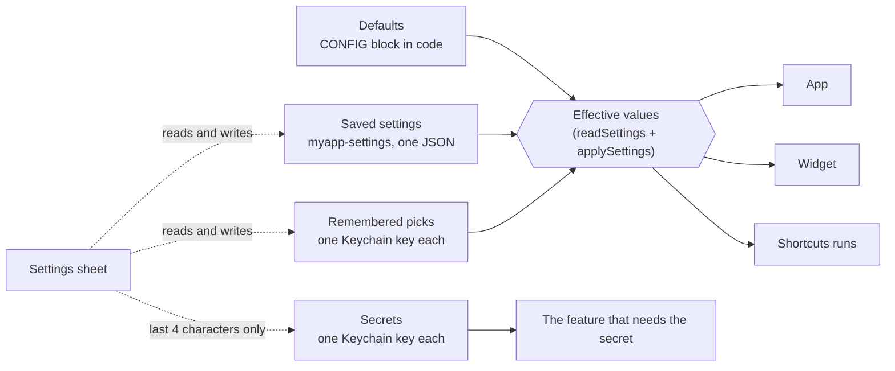

# Settings blueprint for Scriptable apps

Oct 28, 2026 · @Gediminas Siutilas

## Overview

Every value a user might reasonably want different moves out of the code and into a Settings sheet behind a gear icon in the header; the code keeps only the defaults. Users' choices are saved in the iOS Keychain, layered over those defaults at start, so an update never resets them and nobody edits code again.

The reference is StravaFeed v1.8.1 ([Strava Daily Digest.js](https://github.com/gadominas/StravaFeed/blob/main/Strava%20Daily%20Digest.js)): search it for `settingsForPage`, `openSettings` and `settings-save` to see each piece below working together. The blueprint covers what to extract, how to store and apply it, and exactly how the Settings sheet looks and behaves, so every app ends up with the same pattern and the same feel.

> **How this fits with the other blueprints**
>
> - **AI keys, provider, model and effort follow [AI configuration](ai-configuration.md), not this blueprint.** In an app with AI, the main feature's section starts with one **AI settings** row (status line plus button) that opens the AI sheet; there is no API key field, model field or thinking-effort select in this sheet, and AI keys are only ever typed into a native secure alert. The `secret`, `aiModel` and `aiReasoning` examples below show the StravaFeed 1.8.1 starting point, before AI configuration was applied (StravaFeed 1.9.1 shows the result).
> - **Taste choices around AI stay here**: language, tone, default mood and custom prompt are ordinary settings or remembered picks (Step 6).
> - **[In-app updates](in-app-updates.md)** supplies the Updates section: the offer switch, version and **Check now** (Step 8).

## Step 1: audit the hardcoded values

List every literal in the script that changes behaviour, then sort each into one of three places. A value becomes a setting when a reasonable user would want it different and could judge the choice themselves.

| Put it in | When the value is… | Examples |
| --- | --- | --- |
| **Settings sheet** | Personal: an account, key or ID | API keys, athlete or account IDs |
| **Settings sheet** | A matter of taste | Language, tone, default mode, custom prompt |
| **Settings sheet** | A trade-off the user feels | Load extra details (slower start), AI model and effort (cost, speed) |
| **Settings sheet** | Privacy or visibility | Show my own items, names on widgets |
| **Settings sheet** | Behaviour the user may find annoying | Update offers, reminders, sounds |
| **`CONFIG` only** (defaults, not in the sheet) | Useful to tinker with, but meaningless to most users | Concurrency, page limits, debug dumps |
| **Code constant** | Fixed by how the app works | URLs, endpoints, version, Keychain key names, timeouts |

StravaFeed as the worked example, every former hardcoded value and where it ended up:

| Former value | Now | Control in the sheet | Section |
| --- | --- | --- | --- |
| OpenAI API key (pasted on first use) | Secret, own Keychain key | Password field + Remove saved key | AI comments |
| `AI.MODEL` | Setting | Text field | AI comments |
| `AI.REASONING` | Setting | Select: Low, Medium, High | AI comments |
| AI language (EN, LT) | Remembered pick, own Keychain key | Select | AI comments |
| AI mood | Remembered pick, own Keychain key | Select | AI comments |
| Custom prompt | Remembered pick, own Keychain key | Text area, 200 characters | AI comments |
| `INCLUDE_ME` | Setting | Switch | Digest |
| `ENRICH_DETAILS` | Setting | Switch with helper text | Digest |
| `WIDGET_NAMES` | Setting | Switch | Digest |
| `CHECK_UPDATES` | Setting | Switch, plus Check now button | Updates |
| `ATHLETE_ID` | Setting | Numeric text field, empty means detect | Advanced |
| `DAYS_IN_PICKER`, `MAX_PAGES`, `ENRICH_CONCURRENCY`, `DEBUG_DUMP` | `CONFIG` only | None |  |
| Repository URL, `VERSION`, Keychain key names | Code constants | None |  |

The last two rows matter as much as the rest: a sheet with every knob in it is as unusable as code editing. Aim for one screen of settings per section.

## Step 2: the layered model

The app always runs on defaults from the code with the user's saved choices layered on top; secrets and remembered picks live beside them in their own Keychain keys.



Only the effective values reach the app, widget and Shortcuts runs. The sheet reads and writes the three stores, but sees just the last four characters of a secret.

| Store | Holds | Keychain key | Written by |
| --- | --- | --- | --- |
| Defaults | Every setting's starting value | None (the `CONFIG` block) | You, in code |
| Saved settings | Everything the user changed in the sheet | `myapp-settings`, one JSON object | Save |
| Secrets | API keys and tokens | One key each, e.g. `myapp-openai-key` | Save, only when a new value was typed; Remove saved key |
| Remembered picks | Choices also made inline, mid-task | One key each, e.g. `myapp-ai-mode` | Inline controls and Save |

Because updates replace only the script file, everything in the Keychain survives every update.

## Step 3: storage and apply code

Five small functions on the Scriptable side do all of it. Put them together in one section of the script, after the constants.

```javascript
const KC_SETTINGS = 'myapp-settings';          // one Keychain key per app
const DEFAULTS = {                              // snapshot of CONFIG before anything is applied
  includeMe: CONFIG.INCLUDE_ME, enrich: CONFIG.ENRICH_DETAILS,
  checkUpdates: CONFIG.CHECK_UPDATES, aiModel: CONFIG.AI.MODEL, aiReasoning: CONFIG.AI.REASONING,
  accountId: CONFIG.ACCOUNT_ID ? String(CONFIG.ACCOUNT_ID) : '',
};
const REASONING_LEVELS = ['low', 'medium', 'high'];

// 1. Read: defaults first, saved values on top. A broken entry falls back to defaults, never crashes.
function readSettings() {
  try { return Object.assign({}, DEFAULTS, Keychain.contains(KC_SETTINGS) ? JSON.parse(Keychain.get(KC_SETTINGS)) : {}); }
  catch (e) { return Object.assign({}, DEFAULTS); }
}

// 2. Apply: write into CONFIG, validating every value, so the rest of the app keeps reading CONFIG as before.
function applySettings(st) {
  CONFIG.INCLUDE_ME = !!st.includeMe;
  CONFIG.ENRICH_DETAILS = !!st.enrich;
  CONFIG.CHECK_UPDATES = !!st.checkUpdates;
  CONFIG.AI.MODEL = String(st.aiModel || DEFAULTS.aiModel).trim() || DEFAULTS.aiModel;
  CONFIG.AI.REASONING = REASONING_LEVELS.includes(st.aiReasoning) ? st.aiReasoning : DEFAULTS.aiReasoning;
  CONFIG.ACCOUNT_ID = /^\d+$/.test(String(st.accountId || '').trim()) ? String(st.accountId).trim() : (DEFAULTS.accountId || null);
}

// 3. Load: called once at the very start, before any branch (app, widget, Shortcuts run).
function loadSettings() { applySettings(readSettings()); }

// 4. For the page: everything the sheet shows, but never a secret. Only whether a key exists and its last 4 characters.
function settingsForPage() {
  const st = readSettings();
  let tail = '';
  try { if (Keychain.contains(KC_API_KEY)) tail = Keychain.get(KC_API_KEY).slice(-4); } catch (e) {}
  return Object.assign(st, {
    version: VERSION, keySaved: !!tail, keyTail: tail,
    aiLang: STATE.aiLang, aiMode: STATE.aiMode, aiCustom: STATE.aiCustom,
    langs: CONFIG.AI.LANGUAGES, modes: CONFIG.AI.MODES.map(m => ({ key: m.key, label: m.label })), reasoningLevels: REASONING_LEVELS,
  });
}
```

The fifth piece is the save handler in Step 5. Three rules hold throughout:

- **The rest of the app keeps reading `CONFIG`.** Settings only change what is in it, so existing code needs no rewrite.
- **Settings are stored as one JSON object under one Keychain key.** Secrets and remembered picks keep their own keys (Step 2).
- **The option lists come from the code**, not from the page, so adding a language or mode in `CONFIG` appears in the sheet automatically.

## Step 4: UX of the entry point and the sheet

Settings open from a gear icon at the top right of the sticky header, and appear as a bottom sheet over the app, grouped into titled cards with a fixed Cancel and Save bar.

### Entry point

- **Where:** the header's brand row, right-aligned, left of any refresh button. The header is sticky, so Settings is reachable from anywhere.
- **Icon:** a line-drawn gear as inline SVG, never a text symbol like ⚙︎, which fonts draw at unpredictable sizes. Same size, stroke and colour as its neighbours: 22 by 22 points, stroke 2, `currentColor`.
- **Tap target:** 40 by 40 points, transparent background, `aria-label="Settings"`.

### Sheet anatomy

| Part | Spec |
| --- | --- |
| Backdrop | Fixed, full screen, black at 55%. Tap = Cancel. |
| Panel | Bottom sheet, full width, max 92% of the screen height, top corners 20, slides up in 0.22 s. Page background colour. |
| Header | Card colour. Title "Settings" 18 bold on the left; close ✕ on the right, 38 round, soft background, text colour (visible in both themes). |
| Body | Scrolls on its own (`overscroll-behavior: contain`), padding 14. The page behind does not scroll. |
| Section | Small uppercase title, 12 bold, muted, 0.04 em letter spacing, 16 above it. Then one card: card colour, corners 14. |
| Row | Padding 12 by 14, hairline divider between rows. Label 15; optional helper text 12, muted, under it. |
| Footer | Fixed under the body, card colour. Cancel (ghost) and Save (accent), 1 : 2 widths, 12 tall padding, safe-area padding at the bottom. |
| Error line | Red, 13, above the footer, only while there is an error. |

### Controls

| Setting kind | Control | Row layout |
| --- | --- | --- |
| On or off | iOS-style switch, 51 by 31, green when on | Label left, switch right |
| One of a fixed list | `select` styled as a field | Label above, field full width |
| Short text (model name, ID) | Text input, autocorrect and autocapitalise off; numeric keyboard for IDs | Label above, field full width |
| Secret (API key) | Password input that is always empty; status line "Saved key ending …WXYZ"; a Remove saved key button | Label, status, field, button stacked |
| Long text (prompt) | Text area, 3 rows, with a character limit | Label and helper above, field full width |
| Action (Check now) | Small ghost button, never wrapping | Label and result left, button right |
| Read-only info (version) | Row label, result line as helper text | Label left |

All fields use 16-point text, which stops iOS zooming in when they are tapped, and the app's colour variables, so light and dark mode come for free.

### Section order

Order sections by how often people come for them, and keep it the same in every app:

1. **The app's main feature** (StravaFeed: AI comments): keys first, then the choices people change most.
2. **Content and display** (StravaFeed: Digest).
3. **Updates**: the offer switch, then version and Check now. This doubles as the About row.
4. **Advanced**: IDs and anything most people should leave alone, always last.

## Step 5: saving and what happens after Save

Nothing is saved until **Save**, and Save either stores everything or nothing: it validates first, and on any error keeps the sheet open with one red line saying what to fix.

Every setting belongs to one effect class, decided when you add it. The class sets what the app does after saving and what the confirmation says:

| Effect class | What happens after Save | Confirmation | StravaFeed settings |
| --- | --- | --- | --- |
| **Next use** | Nothing visible; the new value is read the next time the feature runs | "Settings saved" | API key, model, thinking effort |
| **Redraw** | The current screen is drawn again from data already loaded | "Settings saved" | Language, mood, custom prompt, names on widget, update offers |
| **Reload** | The data is fetched again, then redrawn | "Saved. Reloading the feed…" | Show my own activities, load extra details |
| **Restart** | Applies the next time the app opens | "Saved. The new athlete ID applies next time you open the digest." | Athlete ID |

The save handler returns the strongest class among the values that changed, and the app acts on that. Validation lives on the Scriptable side, never only in the page:

```javascript
if (head === 'settings-save') {
  let ok = false, msg = '';
  try {
    const v = JSON.parse(p.data || '{}'), before = readSettings();
    const key = String(v.newKey || '').trim();
    if (key && !/^sk-/.test(key)) throw new Error('That API key does not look like an OpenAI key (it starts with sk-).');
    if (v.accountId && !/^\d+$/.test(String(v.accountId).trim())) throw new Error('The account ID is the number in your profile link.');
    const st = {
      includeMe: !!v.includeMe, enrich: !!v.enrich, checkUpdates: !!v.checkUpdates,
      aiModel: String(v.aiModel || '').trim() || DEFAULTS.aiModel,
      aiReasoning: REASONING_LEVELS.includes(v.aiReasoning) ? v.aiReasoning : DEFAULTS.aiReasoning,
      accountId: String(v.accountId || '').trim(),
    };
    Keychain.set(KC_SETTINGS, JSON.stringify(st));
    applySettings(st);
    if (key) Keychain.set(KC_API_KEY, key);                                   // secret: only when a new one was typed
    if (v.removeKey && !key && Keychain.contains(KC_API_KEY)) Keychain.remove(KC_API_KEY);
    // remembered picks (Step 6) are saved through the same helpers the in-app controls use
    ok = true;
    msg = (before.includeMe !== st.includeMe || before.enrich !== st.enrich) ? 'reload' : 'render';
    if (st.accountId !== before.accountId) msg = 'restart';
  } catch (e) { msg = String(e.message || e); }
  await js(`window.__done(${JSON.stringify(p.req)}, ${ok}, ${JSON.stringify(msg)})`);
  if (ok && msg !== 'restart') await showMainScreen(msg === 'reload');   // redraw, or reload then redraw
  return;
}
```

A secret field that is left empty means "keep the saved one", and the only way to delete it is the explicit Remove button. That way, saving any other setting can never wipe a key by accident.

## Step 6: keep settings and in-app controls in sync

Some settings can also be changed right where they are used, like StravaFeed's mood chips and EN/LT buttons in the comment box. Both places must read and write the same value, or the app shows two different answers.

- **One home per value.** Each remembered pick lives in a `STATE` object on the Scriptable side and in its own Keychain key (`myapp-ai-mode`, `myapp-ai-lang`, `myapp-ai-custom`).
- **Inline controls save immediately.** A tap on a mood chip sends `setmode`, which updates `STATE` and the Keychain at once; no Save button.
- **The sheet saves the same keys.** Its Save writes `STATE` and those same Keychain keys, through the same helpers.
- **Both redraw from `STATE`.** The sheet is built fresh from `settingsForPage()` every time it opens, and after Save the main screen is redrawn, so chips show the sheet's choice.
- **Validate in both places.** An inline control and the sheet both reject values not in the code's list, so a stale page can't store a mode that no longer exists.

A setting deserves an inline control only when people change it mid-task (tone of the next comment). Everything else lives only in the sheet.

## Step 7: page-side code for the sheet

The sheet is built from a list of sections and rows, so each app only writes its own `SETTINGS_SCHEMA`; the builder, save and close code stay identical everywhere. It talks to Scriptable through the app's usual bridge, `send(action, params, callback)`. The code is plain ES5 with no backticks or `${`, because the page script usually sits inside a template string on the Scriptable side.

```javascript
// Each app edits only this list. id = key in the settings object; type = one of the controls in Step 4.
var SETTINGS_SCHEMA = [
  { title: 'AI comments', rows: [
    { type: 'secret',   id: 'newKey',      label: 'OpenAI API key', help: 'Create one at platform.openai.com.' },
    { type: 'select',   id: 'aiMode',      label: 'Default mood', options: function (st) { return st.modes.map(function (m) { return [m.key, m.label]; }); } },
    { type: 'textarea', id: 'aiCustom',    label: 'Custom prompt', help: 'Used when the mood is Custom', max: 200 },
    { type: 'select',   id: 'aiLang',      label: 'Language', options: function (st) { return st.langs.map(function (l) { return [l[1], l[1]]; }); } },
    { type: 'text',     id: 'aiModel',     label: 'Model', help: 'OpenAI model name' },
    { type: 'select',   id: 'aiReasoning', label: 'Thinking effort', help: 'Higher is cleverer but slower', options: function (st) { return st.reasoningLevels.map(function (r) { return [r, r.charAt(0).toUpperCase() + r.slice(1)]; }); } } ] },
  { title: 'Content', rows: [
    { type: 'switch', id: 'includeMe', label: 'Show my own activities' },
    { type: 'switch', id: 'enrich',    label: 'Load extra details', help: 'Heart rate, PRs, start times' } ] },
  { title: 'Updates', rows: [
    { type: 'switch', id: 'checkUpdates', label: 'Offer new versions' },
    { type: 'action', id: 'checkNow', label: function (st) { return 'MyApp v' + st.version; }, button: 'Check now', act: 'update-check' } ] },
  { title: 'Advanced', rows: [
    { type: 'text', id: 'accountId', label: 'Account ID', help: 'Leave empty to detect it. Applies next time you open the app.', numeric: true } ] }
];

function escH(t) { var d = document.createElement('div'); d.textContent = String(t == null ? '' : t); return d.innerHTML; }
function rowHtml(r, st) {
  var label = typeof r.label === 'function' ? r.label(st) : r.label, id = 's-' + r.id;
  var head = '<div class="setl">' + escH(label) + (r.help || r.type === 'secret' || r.type === 'action' ? '<small' + (r.type === 'action' ? ' id="' + id + '-msg"' : '') + '>' +
    (r.type === 'secret' ? (st.keySaved ? 'Saved key ending <b>…' + escH(st.keyTail) + '</b>. Paste a new one to replace it.' : 'No key saved yet. ' + escH(r.help || '')) : escH(r.help || '')) + '</small>' : '') + '</div>';
  if (r.type === 'switch') return '<div class="setr">' + head + '<label class="sw"><input type="checkbox" id="' + id + '"' + (st[r.id] ? ' checked' : '') + '><span></span></label></div>';
  if (r.type === 'action') return '<div class="setr">' + head + '<button class="ghost small" data-act="set-action" data-do="' + r.act + '" data-for="' + id + '">' + escH(r.button) + '</button></div>';
  var field = r.type === 'select' ? '<select id="' + id + '">' + r.options(st).map(function (o) { return '<option value="' + escH(o[0]) + '"' + (o[0] === st[r.id] ? ' selected' : '') + '>' + escH(o[1]) + '</option>'; }).join('') + '</select>'
    : r.type === 'textarea' ? '<textarea id="' + id + '" rows="3" maxlength="' + (r.max || 500) + '">' + escH(st[r.id] || '') + '</textarea>'
    : r.type === 'secret' ? '<input type="password" id="' + id + '" autocomplete="off" placeholder="' + (st.keySaved ? 'Paste a new key to replace' : 'Paste your key') + '">' + (st.keySaved ? '<button class="ghost small" data-act="set-removekey">Remove saved key</button>' : '')
    : '<input type="text" id="' + id + '" autocomplete="off" autocapitalize="off" spellcheck="false"' + (r.numeric ? ' inputmode="numeric"' : '') + ' value="' + escH(st[r.id] || '') + '">';
  return '<div class="setr col">' + head + field + '</div>';
}
function openSettings() {
  if (document.getElementById('set')) return;
  send('settings-get', {}, function (ok, msg) {
    var st; try { st = JSON.parse(msg); } catch (e) { toast('Settings could not be loaded'); return; }
    var body = SETTINGS_SCHEMA.map(function (sec) { return '<div class="setg"><h3>' + escH(sec.title) + '</h3><div class="setc">' + sec.rows.map(function (r) { return rowHtml(r, st); }).join('') + '</div></div>'; }).join('');
    var ov = document.createElement('div'); ov.id = 'set';
    ov.innerHTML = '<div class="setp" role="dialog" aria-label="Settings"><div class="seth"><b>Settings</b><button class="lbx" data-act="set-close" aria-label="Close settings">✕</button></div>' +
      '<div class="setb">' + body + '<div class="setmsg" aria-live="polite"></div></div>' +
      '<div class="setf"><button class="ghost" data-act="set-close">Cancel</button><button data-act="set-save">Save</button></div></div>';
    document.body.appendChild(ov); document.body.style.overflow = 'hidden';
    ov.addEventListener('click', function (e) { if (e.target === ov) closeSettings(); });   // backdrop = Cancel
  });
}
function closeSettings() { var ov = document.getElementById('set'); if (ov) ov.remove(); document.body.style.overflow = ''; }
function saveSettings(btn) {
  var ov = document.getElementById('set'), data = { removeKey: ov.dataset.removeKey === '1' };
  SETTINGS_SCHEMA.forEach(function (sec) { sec.rows.forEach(function (r) {
    var el = document.getElementById('s-' + r.id); if (!el || r.type === 'action') return;
    data[r.id] = r.type === 'switch' ? el.checked : el.value.trim();
  }); });
  btn.disabled = true; btn.textContent = 'Saving…';
  send('settings-save', { data: JSON.stringify(data) }, function (ok, msg) {
    btn.disabled = false; btn.textContent = 'Save';
    if (!ok) { var em = ov.querySelector('.setmsg'); em.textContent = msg || 'Could not save'; em.scrollIntoView({ block: 'nearest' }); return; }
    closeSettings();
    toast(msg === 'restart' ? 'Saved. This applies next time you open the app.' : msg === 'reload' ? 'Saved. Reloading…' : 'Settings saved');
  });
}
// In the page's click handler:
//   if (act === 'settings') openSettings();
//   if (act === 'set-close') closeSettings();
//   if (act === 'set-save') saveSettings(t);
//   if (act === 'set-removekey') { var so = document.getElementById('set'); so.dataset.removeKey = '1'; t.disabled = true; t.textContent = 'Key will be removed when you save'; }
//   if (act === 'set-action') { var m = document.getElementById(t.dataset.for + '-msg'); t.disabled = true; if (m) m.textContent = 'Checking…';
//     send(t.dataset.do, {}, function (ok, res) { t.disabled = false; if (m) m.textContent = res || ''; }); }
```

The matching CSS is in StravaFeed's script: copy every rule that starts with `#set`, `.set`, `.sw` and `.keyst`. They use the app's own colour variables (`--bg`, `--card`, `--soft`, `--fg`, `--mut`, `--line`, `--accent`); rename those if the app calls them something else.

## Step 8: wiring

Four connections finish the job:

1. **Load first, everywhere.** Call `loadSettings()` once at the entry point, before the app, widget and Shortcuts branches. Otherwise a widget or automation silently runs on defaults.

   ```javascript
   loadSettings();
   if (config.runsInWidget || config.runsInAccessoryWidget) await renderWidget();
   else if (wantsRefreshOnly) await refreshOnly();
   else await main();
   ```
2. **The header button.** Add the gear before refresh, both as matching line icons (Step 4):

   ```javascript
   `<button class="hbtn" data-act="settings" aria-label="Settings">${ICON_GEAR}</button>` +
   `<button class="hbtn" data-act="refresh" aria-label="Refresh">${ICON_REFRESH}</button>`
   ```
3. **Action handlers** in `shouldAllowRequest`, before any code that needs the app's data loaded, so Settings works even if loading failed: `settings-get` (reply with `JSON.stringify(settingsForPage())`), `settings-save` (Step 5), and `update-check` if the app has the in-app update pattern.
4. **Overlays and gestures.** Add the sheet's id (`set`) to every check for an open overlay, such as pull to refresh, so dragging inside the sheet never reloads the app.

If the app also has the update pattern, its update switch and Check now row belong in the Updates section of this sheet. Check now clears any "Later" snooze and checks immediately.

## Copy guidelines

The words decide whether a user understands a setting without reading the code. Use the same patterns in every app:

| Element | Rule | Do | Don't |
| --- | --- | --- | --- |
| Section title | One or two words, the user's area | AI comments, Digest | AI config, Misc |
| Row label | What the user gets, sentence case | Show my own activities | INCLUDE\_ME, Include own |
| Switch label | Phrased so on means yes | Offer new versions | Disable update offers |
| Helper text | The effect or the trade-off, one short line | Higher is cleverer but slower | Sets the reasoning parameter |
| Empty-means helper | Say what empty does | Leave empty to detect it | Optional |
| Delayed effect | Say when it applies | Takes effect next time you open the digest | (nothing) |
| Secret status | Saved or not, last 4 characters only | Saved key ending …WXYZ | sk-proj-abc… |
| Validation error | What is wrong and what is expected | The athlete ID is the number from strava.com/athletes/\<ID>. | Invalid input |
| Confirmation | What happened, plus what is happening next | Saved. Reloading the feed… | Success! |

Keep option names identical wherever they appear: a mood is called "Funny" in both the sheet and the comment box, never "Humorous" in one.

## Checklist

**Audit**

- [ ] Every literal that changes behaviour is listed and sorted: sheet, `CONFIG` only, or code constant (Step 1).
- [ ] Every sheet setting has a control type, a section, an effect class and copy that follows the guidelines.
- [ ] Secrets have their own Keychain keys and never reach the page.

**Test on a phone**

- [ ] The gear sits left of refresh, both icons the same size.
- [ ] The sheet opens prefilled with current values, in light and dark mode.
- [ ] Cancel, ✕ and tapping the backdrop all close without saving.
- [ ] Each invalid value shows its error line in view, and nothing is saved.
- [ ] Each effect class does what Step 5 says: next use, redraw, reload, restart.
- [ ] Saving without touching the key keeps the saved key; Remove saved key deletes it.
- [ ] Closing and reopening the app keeps every choice.
- [ ] Running the installer or an in-app update keeps every choice.
- [ ] Widgets and Shortcuts runs use the saved values, not the defaults.
- [ ] Inline controls and the sheet always show the same value.
- [ ] Tapping a field doesn't zoom the page, and dragging inside the sheet doesn't trigger pull to refresh.

## Pitfalls learned on StravaFeed

- **Text symbols as icons.** ⚙︎ drew noticeably smaller than ↻ at the same size, so StravaFeed 1.8.1 switched both to SVG line icons.
- **A close button invisible in one theme.** A ✕ styled for dark backgrounds disappeared in light mode. Give it the soft background and text colour, and check both themes.
- **Wrapping buttons.** "Check now" broke onto two lines next to long helper text; buttons in rows need `white-space: nowrap` and `flex: none`.
- **Errors out of sight.** The error line sat below the last field, so a failed save looked like nothing happened. Scroll it into view (Step 7).
- **Action rows with no place for the result.** An action row needs its result line even without helper text, or Check now looks dead (Step 7).
- **Loading settings too late.** Apply saved settings at the entry point, or widgets and Shortcuts runs silently use defaults (Step 8).
- **Keys in the page.** Never send a secret to the page, even to prefill a field. Its last four characters are enough for people to recognise it.

## Prompt for Claude

Paste this into a chat about another app, with this doc's link, to apply the blueprint. Replace the bracketed parts.

```markdown
Add a Settings sheet to [Go2FGym] following the attached "Settings blueprint for Scriptable apps" exactly:

- Repository: github.com/gadominas/[Go2FGym], branch main, script file [Go2FGym.js]
- Keychain key prefix: [go2fgym-]
- First audit every hardcoded value (Step 1) and show me the mapping table before writing code; I'll confirm or adjust it
- Gear icon left of refresh in the sticky header, same SVG icon style and size
- Use the schema-driven builder from Step 7 and StravaFeed's #set, .set, .sw and .keyst CSS, matched to this app's colour variables
- Effect classes and confirmations as in Step 5; copy as in the copy guidelines
- Bump the version and add a releases.json entry with three highlights, if the app has in-app updates
- Test with the checklist in light and dark mode, then commit and push to main (no pull request)
```
