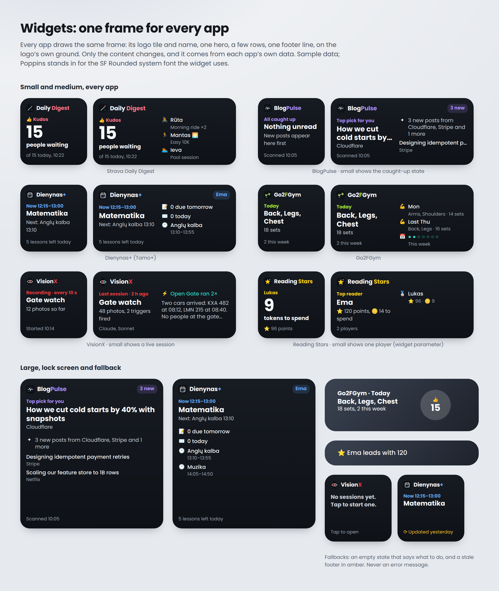

# Widgets for Scriptable apps

> **Status: draft.** Written ahead of its first shipped app, against the rule in the README. VisionX 1.19.0 ships it first and becomes the reference; tag `widgets-v1.0.0` only after that release, and fix this doc wherever VisionX had to differ.

## Overview

Every app's Home Screen widget is drawn by the same frame: the app's logo tile and name at the top, one hero, a few rows, one footer line, on the logo's own dark ground. Only the content changes, and each app fills it from its own data. Side by side on the Home Screen the widgets read as one family, each one names its app (Scriptable only ever labels them "Scriptable"), and a widget never shows a script error.



What the user sees, in every app:

- **Header**: the app's logo tile (the same art as the app icon and launch screen), the app's name with its highlighted part in the accent, and on medium and large an optional badge (`3 new`, `● Live`).
- **Hero**: a short kicker in the accent, then either one big number with its caption, or a title of up to two lines with its caption.
- **Rows**: up to 3 beside the hero on medium, up to 6 under it on large; none on small.
- **Footer**: one muted line. It turns amber, as "⟳ Updated yesterday", when the data is stale.
- **Empty state**: one sentence saying what to do next ("No sessions yet. Tap to start one.").
- **Tap**: opens the app; a row can open its own link.
- **Lock Screen**: inline, circular and rectangular text versions of the same content.

The pieces, all inside the app's single script:

| Piece | Lives in | Job |
| --- | --- | --- |
| `WIDGET` | Top of the Widget section | The only per-app values: name parts, accent, icon URL, words |
| `widgetModel(param)` | Scriptable side, next to the app's data code | Turns the app's own data into the widget model (Step 3) |
| `saveWidget()` / `readWidget()` | Widget section | The snapshot the app saves and the widget reads |
| `widgetIcon()` | Widget section | The logo tile, fetched once per app version and cached |
| `renderWidget(m)`, `renderAccessory()` | Widget section | Draw the shared frame from the model |
| `runWidget()` | Widget section | The only code a widget run executes |
| `widgetRefreshMin`, `widgetStaleMin` | `CONFIG`, group "Widget" | Tunables in Settings |

**A widget run never builds or presents a WebView, Alert or QuickLook, and never shows an error: it shows the model, an empty state, or the plain fallback.**

## Why this blueprint exists

Before it, the six apps' widgets each looked different: an orange gradient in StravaFeed, the light palette in BlogPulse and Dienynas+, a fixed grey in Go2FGym, and no app icon anywhere. VisionX and Reading Stars had no widget code at all, so a widget pointing at them ran the whole app, which tried to present its WebView and Scriptable drew its error on the Home Screen: *"Presenting a configured web view is not supported."*

## The rules

| Rule | What it means |
| --- | --- |
| One frame | Header, hero, rows, footer, in that order, at the sizes in the anatomy table. Apps never draw their own widget layout. |
| Brand colours | The logo tile's ground and lines, the same in light and dark mode, like the launch screen. Only the accent is per app: the logo's focal colour. The Appearance palettes in Settings don't apply to widgets. |
| One hero | One big number or one title per widget. Everything else is a row or the footer. |
| Content from the app | Each app decides what matters at a glance (Step 7); the frame decides how it looks. |
| Fast and offline | The widget reads a snapshot the app saved. If it must fetch, it does so inside the app's own time budget and falls back to the snapshot. |
| Never an error | A failing model gives the empty state; a failing renderer gives the plain fallback (name and "Tap to open"). Errors go to the console only. |
| Nothing private | Never keys, PINs, money a child shouldn't see, or anything the app hides behind a lock. A widget sits on an unlocked Home Screen. |
| Stale is visible | Data older than `widgetStaleMin` replaces the footer with "⟳ Updated <when>" in amber. |
| Text sizes | Never under 11 pt. Text is scaled down to at most 75% before it is cut. |
| The app's language | `WIDGET.words` and every string from `widgetModel()` follow the app's language setting. |

### Anatomy

| Part | Small | Medium | Large |
| --- | --- | --- | --- |
| Padding | 14 | 14 | 14 |
| Logo tile | 18 pt, radius 22.5% | 20 pt | 20 pt |
| Name | bold rounded 13 | 14 | 14 |
| Badge | in the footer if there is no footer | pill, semibold 11.5, accent on 16% accent | same |
| Kicker | semibold 11, accent | same | same |
| Big value + caption | bold 40 + semibold 13 | bold 42, left column 136 pt wide | bold 42 |
| Title + caption | bold 16, 2 lines + regular 12, 2 lines | bold 18 | bold 18 |
| Rows | none | right column, 3 at most, 5.5 line units | under the hero, 6 at most, 12 line units |
| Footer | regular 11, muted | same | same |

A row counts as 1 line unit plus 0.8 for its sub line; a row with `lines: 3` counts 3. Rows that don't fit are left out, never cut in half.

## Step 1: per-app values

| Slot | VisionX value | Rule |
| --- | --- | --- |
| `WIDGET.name` | `['Vision', 'X']` | As on the launch screen: plain part, highlighted part, optional rest (`['Go2', 'F', 'Gym']`) |
| `WIDGET.accent` | `#E5383B` | The launch screen's `--sp-accent` |
| `WIDGET.icon` | `REPO_RAW + 'docs/icon-1024.png'` | The 1024 px app icon every app already has in `docs/` |
| `WIDGET.words` | English | Translate for apps with a language setting |

Every app's accent, from its logo:

| App | `WIDGET.name` | `WIDGET.accent` |
| --- | --- | --- |
| Strava Daily Digest | `['Daily ', 'Digest']` | `#FB7185` |
| BlogPulse | `['Blog', 'Pulse']` | `#A78BFA` |
| Dienynas+ | `[BRAND.name, BRAND.plus]` | `#60A5FA` |
| Go2FGym | `['Go2', 'F', 'Gym']` | `#A3E635` |
| VisionX | `['Vision', 'X']` | `#E5383B` |
| Reading Stars | `['Reading ', 'Stars']` | `#FACC15` |

## Step 2: the frame

Paste this as one section, after `cfg()` and the app's data code and before the entry point. Change only `WIDGET`. If the app already has a `wFont` (StravaFeed does), replace it with this one, which adds the medium weight.

```javascript
// ───────── Widget ─────────
// Shared widget frame (github.com/gadominas/app-blueprints › blueprints/widgets.md).
// An app changes only WIDGET and widgetModel(); everything below WB is the same in every app.
const WIDGET = {
  name: ['Vision', 'X'],                  // as on the launch screen: plain part, highlighted part, optional rest
  accent: '#E5383B',                      // the logo's focal colour (the launch screen's --sp-accent)
  icon: REPO_RAW + 'docs/icon-1024.png',  // the app icon, cached on the phone after the first fetch
  words: { open: 'Tap to open', nothing: 'Nothing to show yet.', updated: 'Updated', yesterday: 'yesterday' },   // in the app's language
};
// Brand colours, the same in every app and in light and dark mode: the logo tile's ground and lines.
const WB = { ground: '#0E1116', raised: '#171B22', ink: '#F6F7F9', ink2: '#C9CED6', muted: '#9AA3AE', good: '#2DD4BF', warn: '#FBBF24' };
const wfm = FileManager.local();
const wPath = (n) => wfm.joinPath(wfm.documentsDirectory(), APP_ID + '-' + n);

// What the widget shows is saved by the app and only read by the widget: fast, offline, no sign-in.
function saveWidget(data) {
  try { wfm.writeString(wPath('widget.json'), JSON.stringify(Object.assign({}, data, { at: Date.now() }))); }
  catch (e) { console.log('Widget: not saved: ' + e); }
}
function readWidget() {
  try { const p = wPath('widget.json'); return wfm.fileExists(p) ? JSON.parse(wfm.readString(p)) : null; }
  catch (e) { return null; }
}

// Tones: ink, soft, muted, accent, good, warn, or a hex colour.
const wColor = (c, a = 1) => {
  const k = c === 'soft' ? 'ink2' : c;
  return new Color(k === 'accent' ? WIDGET.accent : (WB[k] || k), a);
};
// Rounded system fonts, falling back to the plain system font on older Scriptable versions.
function wFont(weight, size) {
  const name = { bold: 'boldRoundedSystemFont', semi: 'semiboldRoundedSystemFont', med: 'mediumRoundedSystemFont' }[weight] || 'regularRoundedSystemFont';
  if (typeof Font[name] === 'function') return Font[name](size);
  return weight === 'bold' ? Font.boldSystemFont(size) : weight === 'semi' ? Font.semiboldSystemFont(size) : weight === 'med' ? Font.mediumSystemFont(size) : Font.systemFont(size);
}
function wText(stack, s, size, weight, tone, lines = 1) {
  const t = stack.addText(String(s));
  t.font = wFont(weight, size);
  t.textColor = wColor(tone);
  t.lineLimit = lines;
  if (lines === 1) t.minimumScaleFactor = 0.75;
  return t;
}
function wWhen(ts) {
  const d = new Date(ts), now = new Date(), f = new DateFormatter();
  const day = (x) => new Date(x.getFullYear(), x.getMonth(), x.getDate()).getTime();
  const ago = Math.round((day(now) - day(d)) / 864e5);
  if (ago === 1) return WIDGET.words.yesterday;
  f.dateFormat = ago === 0 ? 'HH:mm' : 'd MMM';
  return f.string(d);
}

// The app's logo tile, from the repository's icon, cached per app version; a monogram until then.
async function widgetIcon() {
  const p = wPath('widget-icon-' + VERSION + '.png');
  try {
    if (wfm.fileExists(p)) return wfm.readImage(p);
    const r = new Request(WIDGET.icon);
    r.timeoutInterval = 8;
    const dc = new DrawContext();
    dc.size = new Size(96, 96); dc.opaque = false; dc.respectScreenScale = false;
    dc.drawImageInRect(await r.loadImage(), new Rect(0, 0, 96, 96));
    const img = dc.getImage();
    const dir = wfm.documentsDirectory();
    wfm.listContents(dir).filter((f) => f.startsWith(APP_ID + '-widget-icon-')).forEach((f) => { try { wfm.remove(wfm.joinPath(dir, f)); } catch (e) {} });
    wfm.writeImage(p, img);
    return img;
  } catch (e) {
    return widgetMonogram();
  }
}
function widgetMonogram() {
  const dc = new DrawContext();
  dc.size = new Size(96, 96); dc.opaque = false; dc.respectScreenScale = false;
  dc.setFillColor(wColor('raised')); dc.fillRect(new Rect(0, 0, 96, 96));
  dc.setFont(wFont('bold', 54)); dc.setTextColor(wColor('accent')); dc.setTextAlignedCenter();
  dc.drawTextInRect(WIDGET.name.join('').charAt(0), new Rect(0, 14, 96, 70));
  return dc.getImage();
}

// Rows that fit: a line counts 1, a sub line 0.8; medium holds 5.5 (3 rows at most), large 12 (6 at most).
function wFit(rows, budget, max) {
  const out = [];
  let used = 0;
  for (const r of rows || []) {
    const n = (r.lines || 1) + (r.sub ? 0.8 : 0);
    if (out.length >= max || used + n > budget) break;
    used += n;
    out.push(r);
  }
  return out;
}
function wRows(stack, rows) {
  rows.forEach((r, i) => {
    if (i) stack.addSpacer(5);
    const row = stack.addStack();
    row.topAlignContent(); row.spacing = 6;
    if (r.url) row.url = r.url;
    if (r.icon) { const ic = row.addStack(); ic.size = new Size(15, 0); wText(ic, r.icon, 11.5, 'reg', 'ink'); }
    const tx = row.addStack();
    tx.layoutVertically();
    wText(tx, r.text, 12.5, r.lines ? 'reg' : 'med', r.tone || (r.lines ? 'soft' : 'ink'), r.lines || 1);
    if (r.sub) wText(tx, r.sub, 11, 'reg', 'muted');
  });
}

async function renderWidget(m) {
  const fam = config.widgetFamily || 'medium';
  const w = new ListWidget();
  w.url = m.url || URLScheme.forRunningScript();
  w.refreshAfterDate = new Date(Date.now() + cfg('widgetRefreshMin') * 60e3);
  if (fam.startsWith('accessory')) return renderAccessory(w, fam, m);
  const small = fam === 'small', medium = fam === 'medium', large = !small && !medium;
  const g = new LinearGradient();
  g.colors = [wColor('raised'), wColor('ground')]; g.locations = [0, 1];
  g.startPoint = new Point(0, 0); g.endPoint = new Point(0, 1);
  w.backgroundGradient = g;
  w.setPadding(14, 14, 14, 14);

  // 1. Header: logo tile, name (highlighted part in the accent), badge
  const hd = w.addStack();
  hd.centerAlignContent();
  const icon = hd.addImage(await widgetIcon());
  const is = small ? 18 : 20;
  icon.imageSize = new Size(is, is); icon.cornerRadius = is * 0.225;
  hd.addSpacer(6);
  WIDGET.name.forEach((part, i) => {
    if (!part) return;
    const t = hd.addText(part);
    t.font = wFont('bold', small ? 13 : 14); t.textColor = wColor(i === 1 ? 'accent' : 'ink'); t.lineLimit = 1;
  });
  hd.addSpacer();
  if (m.badge && !small) {
    const b = hd.addStack();
    b.setPadding(2, 7, 2, 7); b.cornerRadius = 8;
    b.backgroundColor = wColor(m.badgeTone || 'accent', 0.16);
    wText(b, m.badge, 11.5, 'semi', m.badgeTone || 'accent');
  }
  w.addSpacer(small ? 8 : 10);

  // Empty state: what to do next, never an error
  if (m.empty) {
    wText(w, m.empty, 13, 'semi', 'soft', 3);
    w.addSpacer();
    wText(w, m.footer || WIDGET.words.open, 11, 'reg', 'muted');
    Script.setWidget(w);
    return;
  }

  // 2. Hero: kicker, then a big value with its caption, or a title with its caption
  const body = w.addStack();
  body.topAlignContent();
  const left = body.addStack();
  left.layoutVertically();
  if (medium) left.size = new Size(136, 0);
  if (m.kicker) wText(left, m.kicker, 11, 'semi', m.kickerTone || 'accent');
  if (m.value != null && m.value !== '') {
    wText(left, m.value, small ? 40 : 42, 'bold', m.valueTone || 'ink');
    if (m.caption) wText(left, m.caption, 13, 'semi', 'ink');
  } else {
    if (m.title) wText(left, m.title, small ? 16 : 18, 'bold', 'ink', 2);
    if (m.caption) { left.addSpacer(2); wText(left, m.caption, 12, 'reg', 'soft', 2); }
  }

  // 3. Rows: beside the hero on medium, under it on large, none on small
  const rows = m.rows || [];
  if (medium && wFit(rows, 5.5, 3).length) {
    body.addSpacer(12);
    const right = body.addStack();
    right.layoutVertically();
    wRows(right, wFit(rows, 5.5, 3));
  }
  body.addSpacer();
  if (large && wFit(rows, 12, 6).length) { w.addSpacer(14); wRows(w, wFit(rows, 12, 6)); }

  // 4. Footer: one muted line; amber when the data is stale. Small shows the badge here if there's no footer.
  w.addSpacer();
  const ft = small ? (m.footer || m.badge) : m.footer;
  if (ft) wText(w, (m.stale ? '⟳ ' : '') + ft, 11, 'reg', m.stale ? 'warn' : 'muted');
  Script.setWidget(w);
}

// Lock Screen: iOS tints these, so text only, no colours or logo.
function renderAccessory(w, fam, m) {
  const name = WIDGET.name.join('');
  const a = m.accessory || {};
  const hasValue = m.value != null && m.value !== '';
  const hero = m.empty || (hasValue ? (m.value + ' ' + (m.caption || '')).trim() : (m.title || ''));
  if (fam === 'accessoryInline') {
    w.addText(a.inline || (hero ? name + ': ' + hero : name));
  } else if (fam === 'accessoryCircular') {
    w.addAccessoryWidgetBackground = true;
    const c = w.addStack();
    c.layoutVertically(); c.centerAlignContent();
    const gl = c.addText(a.glyph || name.charAt(0)); gl.font = Font.systemFont(11); gl.centerAlignText();
    const v = c.addText(String(a.value != null ? a.value : hasValue ? m.value : '–'));
    v.font = wFont('bold', 20); v.minimumScaleFactor = 0.5; v.centerAlignText();
  } else {
    const lines = [
      [[name, m.badge || m.kicker].filter(Boolean).join(' · '), 'semi', 12],
      [hero, 'bold', 15],
      [m.empty ? '' : hasValue ? (m.footer || '') : (m.caption || m.footer || ''), 'reg', 12],
    ];
    lines.forEach(([s, wt, size]) => { if (!s) return; const t = w.addText(s); t.font = wFont(wt, size); t.lineLimit = 1; t.minimumScaleFactor = 0.7; });
  }
  Script.setWidget(w);
}

// Widget runs come here and only here: no WebView, Alert or QuickLook may be built or presented.
async function runWidget() {
  const name = WIDGET.name.join('');
  let m = null;
  try { m = await widgetModel(args.widgetParameter || ''); }
  catch (e) { console.error('Widget model: ' + e); }
  if (!m) m = { empty: WIDGET.words.nothing };
  if (m.at && !m.empty && Date.now() - m.at > cfg('widgetStaleMin') * 60e3) {
    m.stale = true;
    m.footer = WIDGET.words.updated + ' ' + wWhen(m.at);
  }
  try {
    await renderWidget(m);
  } catch (e) {
    console.error('Widget render: ' + e);
    const w = new ListWidget();
    w.backgroundColor = wColor('ground');
    w.url = URLScheme.forRunningScript();
    wText(w, name, 14, 'bold', 'ink');
    w.addSpacer(4);
    wText(w, WIDGET.words.open, 12, 'reg', 'muted');
    Script.setWidget(w);
  }
}
// ───────── end of Widget ─────────
```

Rules:

- Keep the names. `wColor`, `wText`, `wFit` and the rest are shared so a fix in one app can be copied to all of them.
- `REPO_RAW`, `APP_ID`, `VERSION` and `cfg` come from the in-app updates and settings blueprints.
- The logo is the PNG from the repository, not a redrawing: Scriptable widgets can't render SVG, and the PNG is the exact app icon. It's cached as `<APP_ID>-widget-icon-<VERSION>.png`, so a new icon arrives with the next app version. Until the first fetch works, the widget shows a monogram tile.

## Step 3: the widget model

`widgetModel(param)` is the one function each app writes. It reads the app's data (the snapshot from Step 5, or its own files) and returns a plain object. `param` is the widget's Parameter field (long-press the widget › Edit Widget), `''` when empty.

| Field | Type | Shown as |
| --- | --- | --- |
| `badge` | string, ≤ 12 characters | Header pill on medium and large; footer on small if there is no `footer` |
| `badgeTone` | tone | Pill colour; default `accent` |
| `kicker` | string | Small line above the hero, accent |
| `kickerTone` | tone | Default `accent` |
| `value` | string or number | Big number. When set, `title` is ignored |
| `valueTone` | tone | Default `ink` |
| `title` | string | Hero title, 2 lines at most |
| `caption` | string | Under the value or title |
| `rows` | array of `{ icon, text, sub, tone, lines, url }` | Rows; `icon` is one emoji or symbol, `lines` lets a row wrap (up to 3), `url` makes it tappable |
| `footer` | string | Bottom line |
| `at` | ms timestamp | When the data was true; drives the stale footer |
| `url` | string | Where a tap on the widget goes; default opens the app |
| `empty` | string | Replaces hero, rows and footer with one sentence saying what to do |
| `accessory` | `{ inline, glyph, value }` | Lock Screen overrides; without them the hero is used |

Tones: `ink`, `soft`, `muted`, `accent`, `good` (teal), `warn` (amber), or a hex colour. Use tones, not colours, so the family stays consistent.

Return `null` to get the generic empty state. Throwing is safe too, but log nothing private.

## Step 4: the entry point

The widget branch comes first, before anything that builds a WebView, and right after settings are loaded. This is the fix for the error widgets.

```javascript
await loadSettings();   // before every branch: app, widget and Shortcuts runs all use the saved choices
if (config.runsInWidget || config.runsInAccessoryWidget) {
  await runWidget();             // never builds or presents a WebView, Alert or QuickLook
} else {
  widgetIcon();                  // caches the logo tile for the widget, in the background
  await main();
}
Script.complete();
```

An app whose start-up runs at the top level of the script (Reading Stars builds its WebView there) first moves that code into `async function main()`, so nothing outside the two branches runs in a widget.

## Step 5: saving the snapshot

The app calls `saveWidget(data)` whenever what the widget shows changes, with only the fields `widgetModel()` needs, never secrets. The widget reads it with `readWidget()`; the file is `<APP_ID>-widget.json` in Scriptable's local Documents, on this device only.

| When | Example |
| --- | --- |
| After the app loads or refreshes its data | StravaFeed after the digest loads; Dienynas+ after TAMO answers |
| After the user changes something the widget shows | Go2FGym after a workout is saved; Reading Stars after a round or a payout |
| On state that lives in the page | The page sends it through the bridge action `widget`, on the action allow-list; the Scriptable side keeps only the allowed fields and calls `saveWidget` |

An app may also refresh inside `widgetModel()` (BlogPulse scans blogs, Dienynas+ asks TAMO) if it stays within its own time-budget tunable and falls back to the snapshot when the budget runs out. Most apps shouldn't: iOS gives a widget run little time and memory.

## Step 6: Settings

Add the group "Widget" to `CONFIG`, or extend the app's existing one. Keep an existing key and its default; only add what is missing.

```javascript
  ["Widget", [
    { k: "widgetRefreshMin", label: "Ask iOS to refresh every", help: "iOS decides the exact timing", unit: "min", def: 30, min: 15, max: 240, step: 15 },
    { k: "widgetStaleMin", label: "Mark the widget as out of date after", help: "Older data shows \"Updated …\" in amber", unit: "min", def: 720, min: 60, max: 2880, step: 60 },
  ]],
```

## Step 7: content per app

What each app shows, from its own logic. Strings are examples; the app writes them in its language.

| App | Badge | Kicker | Hero | Caption | Rows | Footer | Empty |
| --- | --- | --- | --- | --- | --- | --- | --- |
| Strava Daily Digest | — | 👍 Kudos | value: people waiting | people waiting / All caught up 🎉 | Who is waiting: sport icon, name, early-riser mark, ×n; large adds PRs and early risers | of 15 today, 10:22 | Open to load today |
| BlogPulse | `3 new` or `12 unread` | Top pick for you (or the pick's reason) | title: the top pick | its blog | ✦ AI story line (3 lines), then other unread posts with their blog, each linking to the post | Scanned 10:05 | Open BlogPulse to follow your first blogs; caught up: kicker "All caught up", title "Nothing unread" |
| Dienynas+ | the child's first name | Now 12:15–13:00 / Next 13:10 | title: the subject | Next: the following lesson | 📝 due tomorrow (and late), ✉️ messages today (and unread), then the rest of today's lessons | 5 lessons left today | Open to sign in |
| Go2FGym | — | Today / Yesterday / 3 days ago | title: muscle groups of the last workout | its sets | Earlier workouts this week; large adds the week as dots | 2 this week | No workouts yet. Tap to start one |
| VisionX | `● Live` while a session runs | Recording · every 10 s, or Last session · 2 h ago | title: the preset's name | photos so far, or photos and trigger runs | Shortcuts that ran, then the summary (3 lines) | the engine and model, or Started 10:14 | No sessions yet. Tap to start one |
| Reading Stars | — | Top reader | title: the leader | ⭐ points and 🪙 tokens to spend | the other players, ranked | number of players | Add a player to start |

Parameters: Reading Stars takes a player's name and shows that player only, with tokens as the big value; Dienynas+ takes a child's name when the account has more than one. Other apps ignore the parameter.

Privacy per app: Reading Stars never shows money, budgets or the PIN (kids see the Home Screen); Dienynas+ shows no grades or message text; VisionX shows no photos.

Lock Screen: StravaFeed `{ glyph: '👍', inline: '👍 15 waiting for kudos' }`, Reading Stars `{ glyph: '⭐', inline: '⭐ Ema leads with 120' }`; the others use the defaults from the hero.

### Example: VisionX

```javascript
// VisionX: the session running now, else the last saved one. The page saves the live state
// through the bridge action "widget" when a session starts, after each photo and when it stops.
async function widgetModel() {
  const live = readWidget();
  if (live && live.running && Date.now() - live.at < 10 * 60e3) {
    return { badge: '● Live', kicker: 'Recording · every ' + live.interval + ' s', title: live.preset || 'Session',
      caption: live.photos + (live.photos === 1 ? ' photo' : ' photos') + ' so far', footer: 'Started ' + wWhen(live.startedAt),
      accessory: { glyph: '●', value: live.photos } };
  }
  const last = sesIndex().sort((a, b) => (b.endedAt || 0) - (a.endedAt || 0))[0];
  if (!last) return { empty: 'No sessions yet. Tap to start one.' };
  const mins = Math.round((Date.now() - last.endedAt) / 60e3);
  const ago = mins < 60 ? mins + ' min ago' : mins < 1440 ? Math.round(mins / 60) + ' h ago' : wWhen(last.endedAt);
  return {
    kicker: 'Last session · ' + ago,
    title: last.preset || 'Session',
    caption: last.photos + ' photos' + (last.fired ? ', ' + last.fired + (last.fired === 1 ? ' trigger run' : ' trigger runs') : ''),
    rows: last.summary ? [{ text: last.summary, lines: 3 }] : [],
    footer: last.engine,
  };
}
```

`sesIndex()` only reads; don't call `sessionList()` from a widget, because it deletes files.

## Testing checklist

Run these on a phone, with the widget in each size: small, medium, large, and the three Lock Screen kinds.

- [ ] Each size shows the logo tile, the name with its highlighted part and, where there is one, the badge
- [ ] Next to the other apps' widgets, the frame, ground, type and spacing match exactly
- [ ] The content matches the app's row in Step 7, and the numbers match what the app shows
- [ ] A fresh install, before the app is opened, shows the empty state (and a monogram until the logo is fetched)
- [ ] With the app's data older than `widgetStaleMin`, the footer reads "⟳ Updated …" in amber
- [ ] Turning on Airplane Mode still shows the last snapshot
- [ ] A temporary `throw` in `widgetModel()` gives the empty state, and one in `renderWidget()` the plain fallback, never Scriptable's error text
- [ ] Tapping opens the app; tapping a row with a link opens the link (medium and large)
- [ ] The widget parameter, where the app supports one, changes what is shown
- [ ] Nothing private appears in any size
- [ ] In the app's other language, every widget string is translated
- [ ] Opening the app afterwards works as before: the widget branch changed nothing else

## Pitfalls

- **Presenting UI in a widget** (hit in VisionX and Reading Stars). Without the widget branch first, a widget runs the whole app; Scriptable can't present a WebView there and draws its error text on the Home Screen. Step 4 avoids it.
- **SVG logos.** A widget can't show SVG. Use the repository's `icon-1024.png` through `widgetIcon()`; don't redraw the logo with `DrawContext`.
- **Big images.** Widgets have little memory. The icon is cut to 96 px before it is cached; never put a full photo in a widget.
- **Palettes in widgets.** Following the app's Appearance palette made the widgets different from each other again. They use the brand colours, like the launch screen.
- **Side effects.** A widget run can be cut off at any time. Read only; never prune, migrate or write the app's own files from `widgetModel()`.
- **iCloud files.** A file in iCloud Drive may not be downloaded when the widget runs. The snapshot lives in local Documents for that reason.
- **Refresh timing.** `refreshAfterDate` is a request; iOS decides. Don't promise a refresh time in the footer.
- **Template strings.** All of this runs on the Scriptable side, so template literals are fine; nothing here goes into the page.

## Prompt for Claude

Paste this into a chat about another app, with this doc's link. Replace the bracketed parts.

```markdown
Add the shared widget to [App], following the blueprint "widgets" (github.com/gadominas/app-blueprints/blob/main/blueprints/widgets.md) exactly, with VisionX.js as the reference:

- Repository: github.com/gadominas/[App], branch [main], script file [App.js]
- WIDGET: name [['Plain', 'Highlight']], accent [#...]
- Content: as in Step 7 for [App]; widget parameter: [none / what it selects]
- Snapshot saved after: [the moments the widget's data changes]
- Replace the existing widget code, keep existing widget tunables and their keys
- Run the testing checklist in every widget size, bump VERSION, add a releases.json entry, then commit and push to main
- Record it in the app's trace (AGENTS.md › 4): the BLUEPRINTS line, Settings › Built with, and docs/BLUEPRINTS.md
```

## Version history

| Version | Date | Changes |
| --- | --- | --- |
| 1.0.0 | 2026-10-29 | First version, draft until VisionX 1.19.0 ships it |
